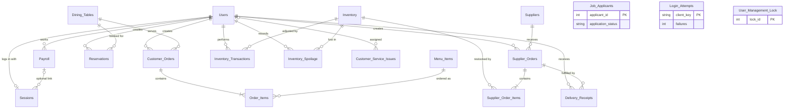

# ServeSync Sprint 4 — Database Guide for Sections 6 and 7

**Source of truth:** [`backend/railway_full_schema.sql`](../../backend/railway_full_schema.sql). This is the script the Railway MySQL database is built from. Everything below was read from that file and from `backend/service.py`.

How to use this file:

| Part | What it is | What to do with it |
| :--- | :--- | :--- |
| A | Plain-English explanation of how the database is organised | Read it first |
| B | What changed since the Sprint 3 document | Use it to update the old tables |
| C | Section 6.0 written out in the Sprint 3 format | Paste into the Sprint 4 document |
| D | Section 7.0 (class diagram, descriptions, multiplicities, notes) | Paste into the Sprint 4 document |

---

## Part A — How the database is structured

ServeSync uses one **MySQL 8** database hosted on Railway. The Flutter app never talks to MySQL directly. Every read and write goes through the Python REST API (`backend/server.py` and `backend/service.py`), which runs each request inside a database transaction.

The database has **19 tables** in five groups:

| Group | Tables | Use cases |
| :--- | :--- | :--- |
| Users and security | `Users`, `Sessions`, `Login_Attempts`, `User_Management_Lock`, `Payroll` | UC-01, UC-08, UC-09 |
| Dining | `Dining_Tables`, `Reservations`, `Menu_Items`, `Customer_Orders`, `Order_Items` | UC-02, UC-03 |
| Inventory | `Inventory`, `Inventory_Transactions`, `Inventory_Spoilage` | UC-04, UC-11 |
| Purchasing | `Suppliers`, `Supplier_Orders`, `Supplier_Order_Items`, `Delivery_Receipts` | UC-05 |
| HR and customer service | `Job_Applicants`, `Customer_Service_Issues` | UC-10, UC-12 |

### The six ideas that explain the design

1. **`Users` is the centre.** Almost every other table points back to `Users` with a foreign key, so every order, shift, reservation, purchase order, delivery, spoilage record and stock change is tied to the employee who did it.

2. **PINs are never stored.** `Users.access_code` holds a salted hash of the PIN (scrypt, with PBKDF2 as a fallback). Because a salted hash cannot be searched, a second column, `Users.pin_lookup`, holds an HMAC-SHA256 of the PIN. Login computes the HMAC of the entered PIN, finds the row by `pin_lookup`, then verifies the hash in `access_code`. `pin_lookup` is `UNIQUE`, which is what enforces "no two employees share a PIN".

3. **A login session and a work shift are two different things.** This is the client requirement from Sprint 3. `Sessions` records who is logged in to the app (one row per logged-in employee, expires after 12 hours). `Payroll` records shifts (one row per clock-in). Logging in does **not** create a `Payroll` row, and logging out does **not** close one. An open shift is a `Payroll` row where `clock_out` is `NULL`.

4. **Header and line tables.** An order is split into a header row and one row per item:
   - `Customer_Orders` (header) and `Order_Items` (lines)
   - `Supplier_Orders` (header) and `Supplier_Order_Items` (lines)

5. **Stock changes leave an audit trail.** `Inventory.quantity` is the current stock. Every change made through the API also writes a row to `Inventory_Transactions` (positive for a delivery, negative for spoilage). Spoilage also writes a detailed row to `Inventory_Spoilage` with the stock before and after.

6. **Duplicate submissions are harmless.** `Inventory_Spoilage.request_id` and `Delivery_Receipts.request_id` are `UNIQUE`. The app sends a unique ID with each submission. If the same request arrives twice (double tap, network retry), the API returns the first result and does not change stock again.

Other rules worth one sentence each in the report:

- **Accounts are deactivated, not deleted.** `DELETE /users/{id}` sets `account_status` to `Inactive`, so payroll and order history are kept.
- **`CHECK` constraints** restrict status columns to their allowed values and stop negative quantities and prices at the database level.
- **`ON DELETE CASCADE`** is used where a child row has no meaning without its parent (`Order_Items`, `Supplier_Order_Items`, `Payroll`, `Sessions`).
- **Two support tables are not business data.** `Login_Attempts` counts failed logins per client so the API can lock out guessing (5 failures in 5 minutes). `User_Management_Lock` holds a single row that the API locks so two account changes cannot run at the same time.

### Which tables the running system actually uses today

This matters for honesty in Sections 6, 7 and 9. A table existing does not mean the feature is finished.

| Status | Tables |
| :--- | :--- |
| **Live end to end** (app → API → MySQL) | `Users`, `Sessions`, `Login_Attempts`, `User_Management_Lock`, `Payroll` (login, clock in, clock out); `Inventory`, `Inventory_Spoilage`, `Inventory_Transactions`; `Suppliers`, `Supplier_Orders`, `Supplier_Order_Items`, `Delivery_Receipts` |
| **API works, no app screen yet** | `Users` create / edit / deactivate / reset PIN; `Job_Applicants` (list, create); `Customer_Service_Issues` (list, create, resolve) |
| **Table exists, read-only API, no app screen** | `Reservations`, `Customer_Orders` (the API can list them; nothing writes to them yet) |
| **Table exists and is seeded, not read by the app** | `Dining_Tables` (8 tables), `Menu_Items` (8 items), `Order_Items` (no API route) |

The floor plan, POS orders and kitchen display currently keep their data in the app and sync it through Cloud Firestore. They do not write to `Customer_Orders` or `Order_Items` in MySQL yet.

---

## Part B — What changed since the Sprint 3 document

**Short answer: yes, the tables changed.** The Sprint 3 document listed 9 tables. The real schema has 19. One Sprint 3 table (`Customer_Reviews`) was never created, 8 were changed, and 11 are new.

### B.1 The Users table (the one in the screenshot)

| Attribute | Sprint 3 document | Real schema now | Changed? |
| :--- | :--- | :--- | :--- |
| `user_id` | INT, Primary Key | INT, Primary Key, **AUTO_INCREMENT** | Yes |
| `Full_name` | VARCHAR(100) | Column is named **`full_name`** (lowercase), VARCHAR(100), NOT NULL | Name fixed |
| `access_code` | VARCHAR(255), "Employee authentication code" | VARCHAR(255), NOT NULL. Stores a **salted hash of the PIN**, never the PIN itself | Description changed |
| `pin_lookup` | *not in Sprint 3* | **New.** CHAR(64), NOT NULL, **UNIQUE**. HMAC-SHA256 of the PIN, used to find the account at login | **New column** |
| `role` | VARCHAR(30) | VARCHAR(30), NOT NULL, **CHECK** in ('FOH Staff', 'Manager', 'Administrator') | Constraint added |
| `account_status` | VARCHAR(20) | VARCHAR(20), NOT NULL, **DEFAULT 'Active'**, **CHECK** in ('Active', 'Inactive') | Default and constraint added |
| `created_at` | DATETIME | DATETIME, NOT NULL, **DEFAULT CURRENT_TIMESTAMP** | Default added |

### B.2 The other Sprint 3 tables

| Sprint 3 table | What changed in the real schema |
| :--- | :--- |
| `Customer_Orders` | `table_number` is now a **foreign key** to `Dining_Tables`. `order_status` gained **'In Prep'** (now Active, In Prep, Completed, Cancelled). Defaults added for status, total and time. |
| `Reservations` | **New columns** `end_time` (TIME) and `table_number` (FK → `Dining_Tables`). Status gained **'Seated'** (now Confirmed, Seated, Cancelled, No-Show). CHECKs: `party_size > 0`, `end_time > reservation_time`. Index on (table, date, time) for availability checks. |
| `Inventory` | **New column** `unit_cost` DECIMAL(10,2). CHECKs: `quantity >= 0`, `reorder_level >= 0`. Note: there is still no supplier foreign key on `Inventory`. |
| `Suppliers` | **New columns** `contact_person` and `created_at`. |
| `Supplier_Orders` | Primary key is named **`order_id`**, not `supplier_order_id`. Status values are now **Pending, Partial, Received, Cancelled** (Sprint 3 said Pending, Completed, Cancelled). |
| `Payroll` | Same columns. `clock_out`, `hours_worked` and `gross_pay` are now **nullable** (they are empty while a shift is open). `hourly_rate` defaults to 16.50. CHECKs added. Deleting a user cascades. |
| `Customer_Reviews` | **Does not exist** in the real schema. See B.4. |
| `Job_Applicants` | **New column** `created_at`. CHECK on `application_status`. |

### B.3 Tables that are in the database but not in the Sprint 3 Section 6 list

`Sessions`, `Login_Attempts`, `User_Management_Lock`, `Dining_Tables`, `Menu_Items`, `Order_Items`, `Inventory_Transactions`, `Inventory_Spoilage`, `Supplier_Order_Items`, `Delivery_Receipts`, `Customer_Service_Issues`.

(Sprint 3's Section 7 class table already mentioned `Sessions`, `Dining_Tables`, `Menu_Items`, `Order_Items` and `Inventory_Transactions`, but Section 6 never defined them.)

Count check: 9 Sprint 3 tables − 1 (`Customer_Reviews`) + 11 = **19**.

### B.4 Two things the team needs to decide

1. **`Customer_Reviews`.** Sprint 3 documented this table for FR-8 (AI review summaries), but it was never created. Either drop it from Section 6, or keep it under a heading such as "Planned tables (not yet created)". The second option keeps Section 6 consistent with 5.2.8 in the table of contents. Part C includes it that way.
2. **The Sprint 3 text about login is now wrong.** Sprint 3 Section 7.0 "User Management Implementation" and the UC-01 description say that logging in records a clock-in and logging out records a clock-out. That is no longer how the system works. Login only starts a session. Clock In and Clock Out are separate buttons, and logging out leaves the shift open. Sections 5 and 7 should say this, and Sprint 3's line "each session belongs to one user and one payroll/shift record" should be removed (`Sessions.payroll_id` is now optional and is not set by the current code).

---

## Part C — Section 6.0, ready to paste

> Format follows Sprint 3: an `Attribute | Data Type | Key/Description` table, then Primary Key, Foreign Key and Relationship lines.

### 6.0 Database Management

ServeSync uses MySQL as its Database Management System (DBMS). The database is hosted on Railway and is accessed only through the ServeSync REST API. It stores the restaurant's users, login sessions, shift and payroll records, dining tables, reservations, menu items, customer orders, inventory, inventory adjustments, spoilage records, suppliers, purchase orders, delivery receipts, job applicants, and customer service issues.

The database uses Primary Keys (PK) to uniquely identify each record and Foreign Keys (FK) to establish relationships between tables. CHECK constraints restrict status fields to their permitted values and prevent negative quantities and prices. The schema contains 19 tables, organised into five groups: users and security, dining, inventory, purchasing, and human resources and customer service.

#### Users and Security

**1. Users Table**

| Attribute | Data Type | Key/Description |
| :--- | :--- | :--- |
| user_id | INT | Primary Key, auto-increment |
| full_name | VARCHAR(100) | Employee's full name |
| access_code | VARCHAR(255) | Salted hash of the employee's four-digit PIN (the PIN itself is never stored) |
| pin_lookup | CHAR(64) | Unique HMAC-SHA256 lookup value used to find the account at login |
| role | VARCHAR(30) | FOH Staff, Manager, or Administrator |
| account_status | VARCHAR(20) | Active or Inactive (default Active) |
| created_at | DATETIME | Date/time account was created |

Primary Key: user_id
Unique: pin_lookup (no two employees can have the same PIN)
Relationship: One user can have many payroll records, orders, reservations, purchase orders, delivery receipts, spoilage records, and inventory transactions.

**2. Sessions Table**

| Attribute | Data Type | Key/Description |
| :--- | :--- | :--- |
| token_hash | CHAR(64) | Primary Key; SHA-256 hash of the session token |
| user_id | INT | Foreign Key → Users.user_id |
| payroll_id | INT | Foreign Key → Payroll.payroll_id; optional (NULL), because logging in does not start a shift |
| expires_at | DATETIME | Date/time the session expires (12 hours after login) |

Primary Key: token_hash
Foreign Keys: user_id references Users(user_id); payroll_id references Payroll(payroll_id)
Relationship: One employee can have at most one active session. Each session belongs to one employee.

**3. Payroll Table**

| Attribute | Data Type | Key/Description |
| :--- | :--- | :--- |
| payroll_id | INT | Primary Key, auto-increment |
| user_id | INT | Foreign Key → Users.user_id |
| clock_in | DATETIME | Employee clock-in time |
| clock_out | DATETIME | Employee clock-out time; empty while the shift is open |
| hours_worked | DECIMAL(6,2) | Total hours worked; calculated at clock-out |
| hourly_rate | DECIMAL(8,2) | Employee hourly rate for the shift |
| gross_pay | DECIMAL(10,2) | Calculated pay (hours_worked × hourly_rate) |
| payment_status | VARCHAR(30) | Pending, Paid, or Pending Correction |

Primary Key: payroll_id
Foreign Key: user_id references Users(user_id)
Relationship: One employee can have many payroll/shift records.

**4. Login_Attempts Table**

| Attribute | Data Type | Key/Description |
| :--- | :--- | :--- |
| client_key | CHAR(64) | Primary Key; hashed identifier of the device/network making login attempts |
| window_start | BIGINT | Start time of the current five-minute counting window |
| failures | INT | Number of failed login attempts in the window |

Primary Key: client_key
Relationship: None. This is a security support table used to lock out repeated incorrect PIN entries (five failures within five minutes).

**5. User_Management_Lock Table**

| Attribute | Data Type | Key/Description |
| :--- | :--- | :--- |
| lock_id | INT | Primary Key; the table holds a single row |

Primary Key: lock_id
Relationship: None. This is a support table. The API locks its single row so that two login or account-management operations cannot run at the same time.

#### Dining

**6. Dining_Tables Table**

| Attribute | Data Type | Key/Description |
| :--- | :--- | :--- |
| table_number | INT | Primary Key; the restaurant's table number |
| capacity | INT | Number of seats at the table |
| status | VARCHAR(20) | Current table status (default Available) |

Primary Key: table_number
Relationship: One dining table can have many reservations and many customer orders over time.

**7. Reservations Table**

| Attribute | Data Type | Key/Description |
| :--- | :--- | :--- |
| reservation_id | INT | Primary Key, auto-increment |
| guest_name | VARCHAR(100) | Customer name |
| phone_number | VARCHAR(20) | Customer contact number |
| party_size | INT | Number of guests (must be greater than 0) |
| reservation_date | DATE | Reservation date |
| reservation_time | TIME | Reservation start time |
| end_time | TIME | Reservation end time (must be after the start time) |
| table_number | INT | Foreign Key → Dining_Tables.table_number |
| status | VARCHAR(20) | Confirmed, Seated, Cancelled, or No-Show |
| created_by | INT | Foreign Key → Users.user_id |

Primary Key: reservation_id
Foreign Keys: created_by references Users(user_id); table_number references Dining_Tables(table_number)
Relationship: One employee can create/manage many reservations. One dining table can have many reservations at different times.

**8. Menu_Items Table**

| Attribute | Data Type | Key/Description |
| :--- | :--- | :--- |
| menu_item_id | INT | Primary Key, auto-increment |
| item_name | VARCHAR(100) | Name of the menu item |
| category | VARCHAR(50) | Entrees, Appetizers, Beverages, Desserts, etc. |
| price | DECIMAL(10,2) | Selling price (cannot be negative) |
| available | BOOLEAN | Whether the item can currently be ordered |

Primary Key: menu_item_id
Relationship: One menu item can appear in many order items.

**9. Customer_Orders Table**

| Attribute | Data Type | Key/Description |
| :--- | :--- | :--- |
| order_id | INT | Primary Key, auto-increment |
| user_id | INT | Foreign Key → Users.user_id (employee who created the order) |
| table_number | INT | Foreign Key → Dining_Tables.table_number |
| order_status | VARCHAR(20) | Active, In Prep, Completed, or Cancelled |
| total_amount | DECIMAL(10,2) | Total order cost |
| order_time | DATETIME | Time order was created |

Primary Key: order_id
Foreign Keys: user_id references Users(user_id); table_number references Dining_Tables(table_number)
Relationship: One employee can create many customer orders. One dining table can have many customer orders. One order contains one or more order items.

**10. Order_Items Table**

| Attribute | Data Type | Key/Description |
| :--- | :--- | :--- |
| order_item_id | INT | Primary Key, auto-increment |
| order_id | INT | Foreign Key → Customer_Orders.order_id |
| menu_item_id | INT | Foreign Key → Menu_Items.menu_item_id |
| quantity | INT | Number ordered (must be greater than 0) |
| unit_price | DECIMAL(10,2) | Price of one item at the time of the order |
| modifications | VARCHAR(255) | Customer modifications, such as "no cheese" (optional) |

Primary Key: order_item_id
Foreign Keys: order_id references Customer_Orders(order_id); menu_item_id references Menu_Items(menu_item_id)
Relationship: Each order item belongs to one customer order and references one menu item. Deleting an order deletes its order items.

#### Inventory

**11. Inventory Table**

| Attribute | Data Type | Key/Description |
| :--- | :--- | :--- |
| inventory_id | INT | Primary Key, auto-increment |
| item_name | VARCHAR(100) | Ingredient or supply name |
| category | VARCHAR(50) | Item category |
| quantity | DECIMAL(10,2) | Current amount available (cannot be negative) |
| unit | VARCHAR(20) | lbs, units, boxes, etc. |
| reorder_level | DECIMAL(10,2) | Minimum acceptable quantity |
| unit_cost | DECIMAL(10,2) | Cost of one unit |
| last_updated | DATETIME | Last inventory update |

Primary Key: inventory_id
Relationship: One inventory item can have many inventory transactions, spoilage records, and purchase order lines.

**12. Inventory_Transactions Table**

| Attribute | Data Type | Key/Description |
| :--- | :--- | :--- |
| transaction_id | INT | Primary Key, auto-increment |
| inventory_id | INT | Foreign Key → Inventory.inventory_id |
| user_id | INT | Foreign Key → Users.user_id (employee responsible) |
| quantity_change | DECIMAL(10,2) | Amount added (positive) or removed (negative) |
| reason | VARCHAR(100) | Reason for the change, such as a delivery receipt or spoilage |
| timestamp | DATETIME | Date/time of the change |

Primary Key: transaction_id
Foreign Keys: inventory_id references Inventory(inventory_id); user_id references Users(user_id)
Relationship: Each transaction applies to one inventory item and records one responsible employee.

**13. Inventory_Spoilage Table**

| Attribute | Data Type | Key/Description |
| :--- | :--- | :--- |
| spoilage_id | INT | Primary Key, auto-increment |
| inventory_id | INT | Foreign Key → Inventory.inventory_id |
| quantity_spoiled | DECIMAL(10,2) | Amount lost |
| reason | VARCHAR(100) | Expired, damaged, contaminated, etc. |
| notes | TEXT | Optional comments |
| recorded_by | INT | Foreign Key → Users.user_id |
| occurred_at | DATETIME | Date/time the spoilage was recorded |
| stock_before | DECIMAL(10,2) | Stock quantity before the deduction |
| stock_after | DECIMAL(10,2) | Stock quantity after the deduction |
| request_id | VARCHAR(64) | Unique submission identifier; prevents the same record being saved twice |

Primary Key: spoilage_id
Foreign Keys: inventory_id references Inventory(inventory_id); recorded_by references Users(user_id)
Relationship: One inventory item can have many spoilage records. One employee can record many spoilage records.

#### Purchasing

**14. Suppliers Table**

| Attribute | Data Type | Key/Description |
| :--- | :--- | :--- |
| supplier_id | INT | Primary Key, auto-increment |
| supplier_name | VARCHAR(100) | Supplier/company name |
| contact_person | VARCHAR(100) | Name of the supplier's contact |
| phone_number | VARCHAR(20) | Supplier phone number |
| email | VARCHAR(100) | Supplier email |
| product_category | VARCHAR(100) | Type of products supplied |
| created_at | DATETIME | Date/time the supplier was added |

Primary Key: supplier_id
Relationship: One supplier can receive many supplier orders.

**15. Supplier_Orders Table**

| Attribute | Data Type | Key/Description |
| :--- | :--- | :--- |
| order_id | INT | Primary Key, auto-increment |
| supplier_id | INT | Foreign Key → Suppliers.supplier_id |
| created_by | INT | Foreign Key → Users.user_id |
| order_date | DATETIME | Date order was placed |
| total_amount | DECIMAL(10,2) | Purchase order total |
| status | VARCHAR(20) | Pending, Partial, Received, or Cancelled |

Primary Key: order_id
Foreign Keys: supplier_id references Suppliers(supplier_id); created_by references Users(user_id)
Relationships: One supplier can receive many supplier orders. One manager can create many supplier orders. One supplier order contains one or more order lines.

**16. Supplier_Order_Items Table**

| Attribute | Data Type | Key/Description |
| :--- | :--- | :--- |
| item_id | INT | Primary Key, auto-increment |
| order_id | INT | Foreign Key → Supplier_Orders.order_id |
| inventory_id | INT | Foreign Key → Inventory.inventory_id |
| quantity_ordered | DECIMAL(10,2) | Amount ordered |
| quantity_received | DECIMAL(10,2) | Amount received so far (default 0) |
| unit_cost | DECIMAL(10,2) | Cost of one unit on this order |

Primary Key: item_id
Foreign Keys: order_id references Supplier_Orders(order_id); inventory_id references Inventory(inventory_id)
Relationship: Each order line belongs to one supplier order and refers to one inventory item. Deleting a supplier order deletes its lines.

**17. Delivery_Receipts Table**

| Attribute | Data Type | Key/Description |
| :--- | :--- | :--- |
| receipt_id | INT | Primary Key, auto-increment |
| order_id | INT | Foreign Key → Supplier_Orders.order_id |
| received_by | INT | Foreign Key → Users.user_id |
| receipt_date | DATETIME | Date/time the delivery was recorded |
| request_id | VARCHAR(64) | Unique submission identifier; prevents the same delivery being recorded twice |
| notes | TEXT | Optional comments |

Primary Key: receipt_id
Foreign Keys: order_id references Supplier_Orders(order_id); received_by references Users(user_id)
Relationship: One supplier order can have many delivery receipts (partial deliveries). One employee can record many delivery receipts.

#### Human Resources and Customer Service

**18. Job_Applicants Table**

| Attribute | Data Type | Key/Description |
| :--- | :--- | :--- |
| applicant_id | INT | Primary Key, auto-increment |
| full_name | VARCHAR(100) | Applicant's name |
| email | VARCHAR(100) | Applicant's email |
| phone_number | VARCHAR(20) | Applicant's phone number |
| applied_position | VARCHAR(100) | Position applied for |
| availability | VARCHAR(100) | Applicant availability |
| years_experience | INT | Years of experience (default 0) |
| resume_path | VARCHAR(255) | Location of uploaded resume (optional) |
| application_status | VARCHAR(30) | New, Reviewed, Interview, Rejected, or Hired |
| created_at | DATETIME | Date/time the application was received |

Primary Key: applicant_id
Relationship: None. A hired applicant becomes an employee when an administrator creates a separate Users account.

**19. Customer_Service_Issues Table**

| Attribute | Data Type | Key/Description |
| :--- | :--- | :--- |
| issue_id | INT | Primary Key, auto-increment |
| category | VARCHAR(50) | Type of issue |
| description | TEXT | Details of the customer's issue |
| customer_contact | VARCHAR(100) | Customer contact information (optional) |
| status | VARCHAR(20) | Open, In Progress, or Resolved |
| reported_at | DATETIME | Date/time the issue was recorded |
| assigned_to | INT | Foreign Key → Users.user_id (optional) |
| resolution_notes | TEXT | How the issue was resolved |
| resolved_at | DATETIME | Date/time the issue was resolved |

Primary Key: issue_id
Foreign Key: assigned_to references Users(user_id)
Relationship: One employee can be assigned many customer service issues. An issue may be unassigned.

#### Planned Tables (not yet created)

**Customer_Reviews Table** — planned for FR-8 (AI-powered review summaries). This table was designed in Sprint 3 but has not been created in the database, because the review feature has not been implemented.

| Attribute | Data Type | Key/Description |
| :--- | :--- | :--- |
| review_id | INT | Primary Key |
| customer_name | VARCHAR(100) | Customer/reviewer name |
| rating | INT | Customer rating |
| review_text | TEXT | Customer's written feedback |
| review_source | VARCHAR(50) | Source such as Google Reviews |
| review_date | DATE | Date of review |
| ai_summary | TEXT | AI-generated review summary |

#### Database Relationships

The main relationships within the ServeSync database are:

- Users → Sessions: One-to-One (at most one active session per employee)
- Users → Payroll: One-to-Many
- Users → Customer_Orders: One-to-Many
- Users → Reservations: One-to-Many
- Users → Supplier_Orders: One-to-Many
- Users → Delivery_Receipts: One-to-Many
- Users → Inventory_Transactions: One-to-Many
- Users → Inventory_Spoilage: One-to-Many
- Users → Customer_Service_Issues: One-to-Many (optional)
- Dining_Tables → Reservations: One-to-Many
- Dining_Tables → Customer_Orders: One-to-Many
- Customer_Orders → Order_Items: One-to-Many
- Menu_Items → Order_Items: One-to-Many
- Inventory → Inventory_Transactions: One-to-Many
- Inventory → Inventory_Spoilage: One-to-Many
- Inventory → Supplier_Order_Items: One-to-Many
- Suppliers → Supplier_Orders: One-to-Many
- Supplier_Orders → Supplier_Order_Items: One-to-Many
- Supplier_Orders → Delivery_Receipts: One-to-Many

These relationships allow ServeSync to connect restaurant activities to the appropriate employee, table, inventory item, or supplier while reducing unnecessary duplication of information.

#### Entity-Relationship Diagram

#### Database Management System

Selected DBMS: MySQL

MySQL is used because it is a relational database management system that supports tables, primary keys, foreign keys, relationships, transactions, and SQL queries. It is appropriate for ServeSync because the application's data is structured and many parts of the system are related to each other.

The database is hosted on Railway (MySQL 8, InnoDB storage engine, utf8mb4 character set). On startup, the ServeSync API checks that all 19 tables exist and creates any that are missing from the schema script, so the database structure can be recreated for development, testing, and demonstration. Operations that change several tables together, such as receiving a delivery or recording spoilage, run inside a single transaction so that either all changes are saved or none are.

---

## Part D — Section 7.0, ready to paste

### 7.0 Class Diagram

The UML class diagram below models the principal objects in the ServeSync database implementation. It identifies the classes, major attributes, representative operations, associations, and multiplicities for user management, payroll/shift records, customer orders, reservations, inventory, spoilage, purchasing, job applicants, and customer service.

```mermaid
classDiagram
    direction LR

    class Users {
        +int user_id
        +String full_name
        -String access_code
        -String pin_lookup
        +String role
        +String account_status
        +DateTime created_at
        +login(pin)
        +createUser(name, role, pin)
        +updateUser(name, role, status)
        +resetPin(pin)
        +deactivate()
    }
    class Sessions {
        -String token_hash
        +int user_id
        +int payroll_id
        +DateTime expires_at
        +authenticate(token)
        +logout()
        +endSession(user_id)
    }
    class Payroll {
        +int payroll_id
        +int user_id
        +DateTime clock_in
        +DateTime clock_out
        +Decimal hours_worked
        +Decimal hourly_rate
        +Decimal gross_pay
        +String payment_status
        +clockIn()
        +clockOut()
        +getShiftStatus()
    }
    class Dining_Tables {
        +int table_number
        +int capacity
        +String status
    }
    class Reservations {
        +int reservation_id
        +String guest_name
        +String phone_number
        +int party_size
        +Date reservation_date
        +Time reservation_time
        +Time end_time
        +int table_number
        +String status
        +int created_by
        +listReservations()
    }
    class Menu_Items {
        +int menu_item_id
        +String item_name
        +String category
        +Decimal price
        +bool available
    }
    class Customer_Orders {
        +int order_id
        +int user_id
        +int table_number
        +String order_status
        +Decimal total_amount
        +DateTime order_time
        +listOrders()
    }
    class Order_Items {
        +int order_item_id
        +int order_id
        +int menu_item_id
        +int quantity
        +Decimal unit_price
        +String modifications
    }
    class Inventory {
        +int inventory_id
        +String item_name
        +String category
        +Decimal quantity
        +String unit
        +Decimal reorder_level
        +Decimal unit_cost
        +DateTime last_updated
        +getInventory()
    }
    class Inventory_Transactions {
        +int transaction_id
        +int inventory_id
        +int user_id
        +Decimal quantity_change
        +String reason
        +DateTime timestamp
    }
    class Inventory_Spoilage {
        +int spoilage_id
        +int inventory_id
        +Decimal quantity_spoiled
        +String reason
        +String notes
        +int recorded_by
        +DateTime occurred_at
        +Decimal stock_before
        +Decimal stock_after
        +String request_id
        +recordSpoilage()
        +getSpoilageHistory()
    }
    class Suppliers {
        +int supplier_id
        +String supplier_name
        +String contact_person
        +String phone_number
        +String email
        +String product_category
        +getSuppliers()
    }
    class Supplier_Orders {
        +int order_id
        +int supplier_id
        +int created_by
        +DateTime order_date
        +Decimal total_amount
        +String status
        +createPurchaseOrder()
        +receiveDelivery()
        +getPurchaseOrders()
    }
    class Supplier_Order_Items {
        +int item_id
        +int order_id
        +int inventory_id
        +Decimal quantity_ordered
        +Decimal quantity_received
        +Decimal unit_cost
    }
    class Delivery_Receipts {
        +int receipt_id
        +int order_id
        +int received_by
        +DateTime receipt_date
        +String request_id
        +String notes
    }
    class Job_Applicants {
        +int applicant_id
        +String full_name
        +String email
        +String phone_number
        +String applied_position
        +String availability
        +int years_experience
        +String resume_path
        +String application_status
        +createApplicant()
        +getApplicants()
    }
    class Customer_Service_Issues {
        +int issue_id
        +String category
        +String description
        +String customer_contact
        +String status
        +DateTime reported_at
        +int assigned_to
        +String resolution_notes
        +DateTime resolved_at
        +createIssue()
        +resolveIssue(notes)
    }

    Users "1" *-- "0..1" Sessions : owns
    Users "1" *-- "0..*" Payroll : owns
    Payroll "0..1" -- "0..*" Sessions : optional link
    Users "1" -- "0..*" Customer_Orders : creates
    Users "1" -- "0..*" Reservations : creates
    Users "1" -- "0..*" Supplier_Orders : creates
    Users "1" -- "0..*" Delivery_Receipts : receives
    Users "1" -- "0..*" Inventory_Transactions : performs
    Users "1" -- "0..*" Inventory_Spoilage : records
    Users "0..1" -- "0..*" Customer_Service_Issues : assigned to
    Dining_Tables "1" o-- "0..*" Reservations : has
    Dining_Tables "1" -- "0..*" Customer_Orders : placed at
    Customer_Orders "1" *-- "1..*" Order_Items : contains
    Menu_Items "1" -- "0..*" Order_Items : ordered as
    Inventory "1" o-- "0..*" Inventory_Transactions : history
    Inventory "1" o-- "0..*" Inventory_Spoilage : losses
    Inventory "1" -- "0..*" Supplier_Order_Items : restocked by
    Suppliers "1" -- "0..*" Supplier_Orders : receives
    Supplier_Orders "1" *-- "1..*" Supplier_Order_Items : contains
    Supplier_Orders "1" o-- "0..*" Delivery_Receipts : fulfilled by
```

> **Sprint 3 feedback: "Class diagram → 80%. Missing aggregations."** The Sprint 3 diagram drew every relationship as a plain line. This version marks the whole–part relationships with diamonds, and Section 7.3 below explains each one. When redrawing it in draw.io or Lucidchart, the diamond goes on the **whole** side: a **filled** diamond for composition and a **hollow** diamond for aggregation.

### 7.1 Class Descriptions

| Class | Purpose | Key Relationships |
| :--- | :--- | :--- |
| Users | Represents employee accounts, roles, status, and authentication information. | One user can have many payroll records, orders, reservations, purchase orders, delivery receipts, spoilage records, and inventory transactions; a user can have at most one active session. |
| Sessions | Represents an authenticated staff session and its expiration. | Each session belongs to one user. A session is independent of the shift: logging in does not clock the employee in. |
| Payroll | Stores clock-in, clock-out, hours, pay rate, gross pay, and payment status. | Each payroll record belongs to one user. A record with no clock-out time is the employee's open shift. |
| Dining_Tables | Stores restaurant table number, seating capacity, and status. | One dining table can be associated with many reservations and many customer orders over time. |
| Reservations | Stores guest, party, date/time, table, status, and creator information. | Each reservation is created by one user and assigned to one dining table. |
| Menu_Items | Stores menu item name, category, price, and availability. | One menu item can appear in many order-item records. |
| Customer_Orders | Stores a dining order created by an employee for a restaurant table. | Each order is associated with one user and one dining table and contains one or more order items. |
| Order_Items | Represents individual menu selections within an order. | Each order item belongs to one order and references one menu item. |
| Inventory | Stores tracked stock, category, unit, quantity, reorder level, and unit cost. | One inventory item can have many inventory transactions, spoilage records, and purchase order lines. |
| Inventory_Transactions | Stores quantity changes, reasons, timestamps, and responsible staff. | Each transaction belongs to one inventory item and one user. |
| Inventory_Spoilage | Stores spoiled quantity, reason, notes, and the stock level before and after the loss. | Each spoilage record belongs to one inventory item and is recorded by one user. |
| Suppliers | Stores supplier name, contact details, and product category. | One supplier can receive many supplier orders. |
| Supplier_Orders | Stores a purchase order placed with a supplier, its total, and its status. | Each supplier order belongs to one supplier, is created by one user, contains one or more order lines, and can have many delivery receipts. |
| Supplier_Order_Items | Represents one inventory item on a purchase order, with ordered and received quantities. | Each line belongs to one supplier order and references one inventory item. |
| Delivery_Receipts | Records each delivery received against a purchase order. | Each receipt belongs to one supplier order and is recorded by one user. |
| Job_Applicants | Stores applicant contact details, position, experience, resume location, and application status. | No direct association. A hired applicant is given a separate Users account by an administrator. |
| Customer_Service_Issues | Stores customer complaints or requests, their status, and how they were resolved. | An issue may be assigned to one user; one user can be assigned many issues. |

### 7.2 Associations and Multiplicities

- Users 1 - 0..1 Sessions: an employee may have no active session or one active session; each session belongs to one employee.
- Users 1 - 0..* Payroll: one employee may have many shift/payroll records; each payroll record belongs to one employee.
- Payroll 0..1 - 0..* Sessions: a session may optionally reference a payroll/shift record; a payroll record remains after the session ends.
- Users 1 - 0..* Customer_Orders: one employee may create many customer orders; each order is associated with one employee.
- Dining_Tables 1 - 0..* Customer_Orders: one table may have many orders over time; each order is placed at one table.
- Customer_Orders 1 - 1..* Order_Items: an order contains one or more order items; each order item belongs to one order.
- Menu_Items 1 - 0..* Order_Items: one menu item may appear in many order-item records; each order item references one menu item.
- Users 1 - 0..* Reservations: one employee may create many reservations; each reservation records one creating employee.
- Dining_Tables 1 - 0..* Reservations: one table may be associated with many reservations at different times; each reservation references one table.
- Inventory 1 - 0..* Inventory_Transactions: one inventory item may have many adjustment records; each transaction applies to one inventory item.
- Users 1 - 0..* Inventory_Transactions: one employee may perform many inventory adjustments; each adjustment records one responsible employee.
- Inventory 1 - 0..* Inventory_Spoilage: one inventory item may have many spoilage records; each spoilage record applies to one inventory item.
- Users 1 - 0..* Inventory_Spoilage: one employee may record many spoilage records; each record identifies the employee who recorded it.
- Suppliers 1 - 0..* Supplier_Orders: one supplier may receive many purchase orders; each purchase order is placed with one supplier.
- Users 1 - 0..* Supplier_Orders: one manager or administrator may create many purchase orders; each purchase order records its creator.
- Supplier_Orders 1 - 1..* Supplier_Order_Items: a purchase order contains one or more order lines; each line belongs to one purchase order.
- Inventory 1 - 0..* Supplier_Order_Items: one inventory item may appear on many purchase order lines; each line references one inventory item.
- Supplier_Orders 1 - 0..* Delivery_Receipts: one purchase order may be received in several deliveries; each receipt belongs to one purchase order.
- Users 1 - 0..* Delivery_Receipts: one employee may record many delivery receipts; each receipt records the employee who received it.
- Users 0..1 - 0..* Customer_Service_Issues: an issue may be unassigned or assigned to one employee; one employee may be assigned many issues.

### 7.3 Aggregation and Composition

Some associations in the model are whole–part relationships. They are shown with a diamond at the "whole" end of the line.

**Composition (filled diamond).** The part cannot exist without the whole. If the whole is deleted, its parts are deleted with it. In the schema these are the foreign keys declared `ON DELETE CASCADE`.

| Whole | Part | Multiplicity | Why it is composition |
| :--- | :--- | :--- | :--- |
| Customer_Orders | Order_Items | 1 to 1..* | An order item has no meaning without its order. Deleting an order deletes its items. |
| Supplier_Orders | Supplier_Order_Items | 1 to 1..* | A purchase order line exists only as part of its purchase order. Deleting the order deletes its lines. |
| Users | Payroll | 1 to 0..* | A shift/payroll record belongs to exactly one employee and is removed if that employee's account is removed. |
| Users | Sessions | 1 to 0..1 | A login session exists only for its employee and is removed with the account. |

**Aggregation (hollow diamond).** The whole groups its parts, but each part is kept as a record in its own right and is not deleted through the whole. In the schema these foreign keys have no cascade rule.

| Whole | Part | Multiplicity | Why it is aggregation |
| :--- | :--- | :--- | :--- |
| Inventory | Inventory_Transactions | 1 to 0..* | The transactions form the stock history of an inventory item. They are a permanent audit trail, so the database refuses to delete an inventory item that still has transactions. |
| Inventory | Inventory_Spoilage | 1 to 0..* | The spoilage records form the loss history of an inventory item and are kept for auditing. |
| Supplier_Orders | Delivery_Receipts | 1 to 0..* | A purchase order is fulfilled by a collection of delivery receipts (partial deliveries). Each receipt is an independent record of what arrived and who received it. |
| Dining_Tables | Reservations | 1 to 0..* | A dining table holds a collection of reservations over time. A reservation is an independent booking that can be cancelled or moved without affecting the table. |

All other lines in the diagram are ordinary associations, because neither class is a part of the other. For example, Users creates Customer_Orders, and Order_Items refers to Menu_Items, but an order is not part of an employee and a menu item is not part of an order item.

In practice ServeSync never deletes employee accounts. An administrator deactivates the account instead, so payroll history is preserved. The composition between Users and Payroll describes ownership in the data model, not a routine operation.

### 7.4 Class Model Notes

The diagram mirrors the tables in the ServeSync MySQL schema. Login_Attempts and User_Management_Lock are implementation-support tables rather than restaurant domain objects, so they are not shown as UML classes.

Compared with Sprint 3, the model now includes the purchasing classes (Suppliers, Supplier_Orders, Supplier_Order_Items, Delivery_Receipts), Inventory_Spoilage, Job_Applicants, and Customer_Service_Issues, which were listed in Sprint 3 as requirements that were not yet represented.

The association between Sessions and Payroll changed. In Sprint 3 every session was linked to a payroll record because logging in also clocked the employee in. At the client's request, login and clock-in are now separate actions, so a session exists without a shift and the link is optional.

The operations shown are those implemented in the backend service. Reservations and Customer_Orders currently support listing only; creating and updating them through the API is planned. Dining_Tables, Menu_Items, and Order_Items are defined in the database but do not yet have API operations, because the floor plan and point-of-sale screens currently hold their data in the application and synchronise it through Cloud Firestore.

Other requirements, including customer reviews and AI summaries (FR-8), AI consumption analytics (FR-10), menu and price management (FR-13, FR-14), and delivery-platform integration (FR-15), remain part of the ServeSync requirements but are not represented as implemented classes in the schema.

> **Rule the multiplicities come from** (not for the report, just so you can check them): a `NOT NULL` foreign key gives "1" on the parent side; a nullable foreign key gives "0..1". The child side is "0..\*" unless the API refuses to create the parent without at least one child, which is the case for purchase order lines ("1..\*"). "At most one active session" is enforced by the login code, not by a database constraint.
