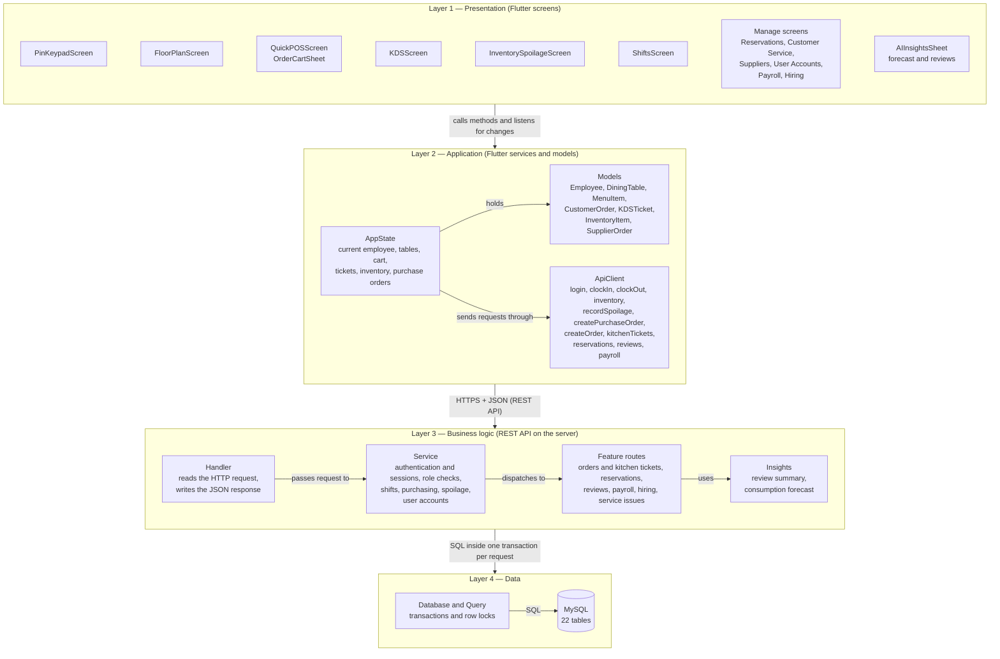
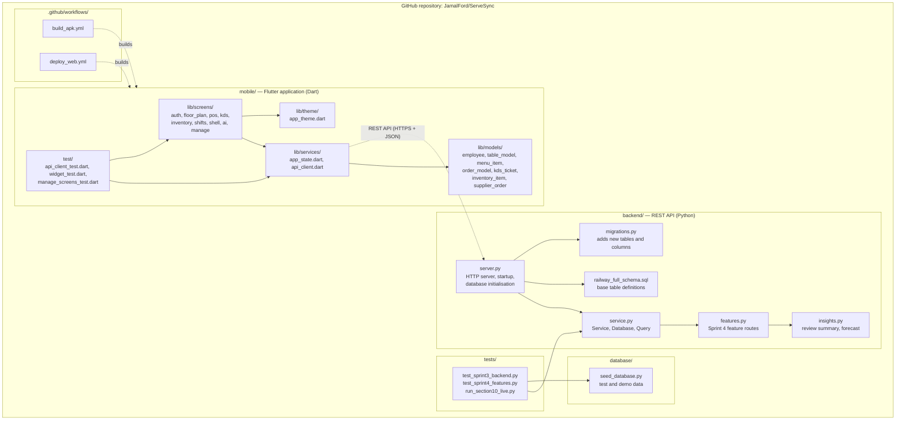
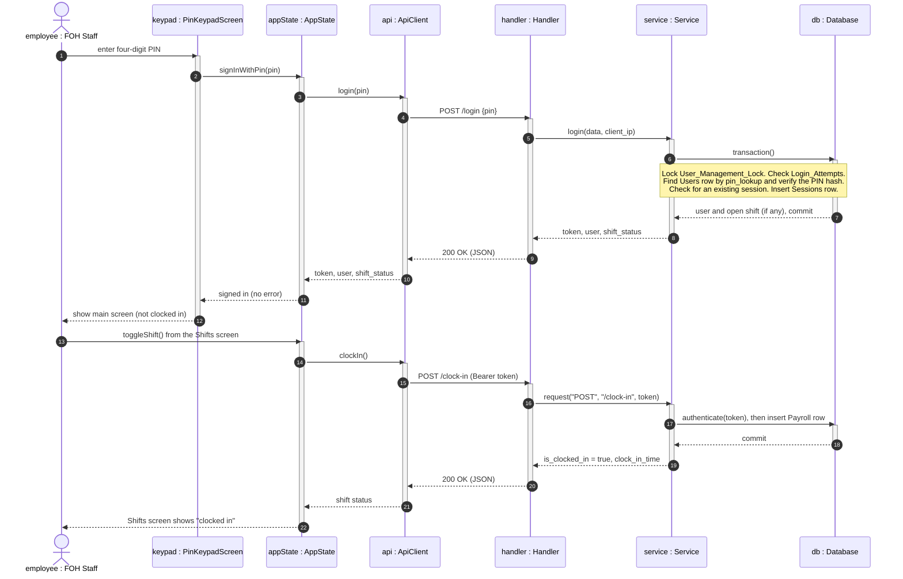
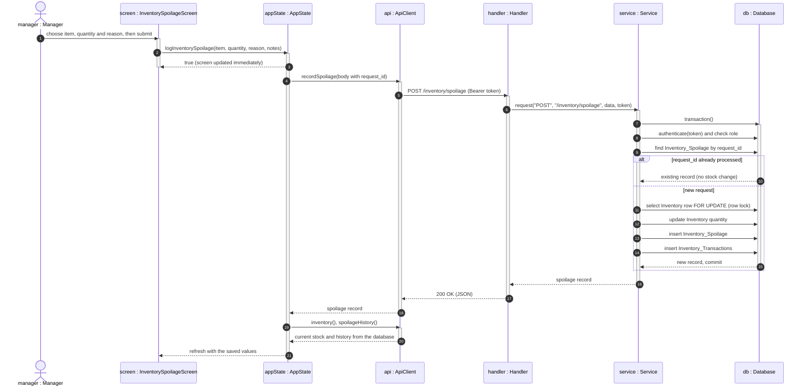
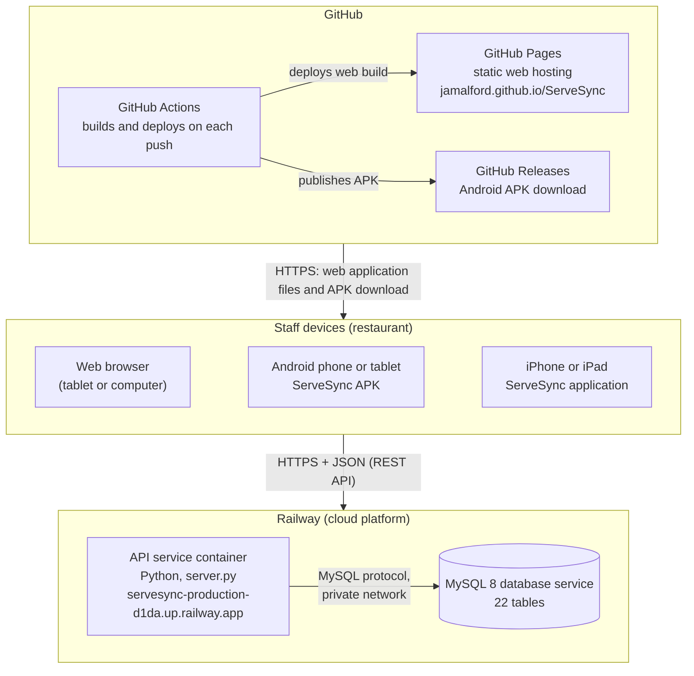
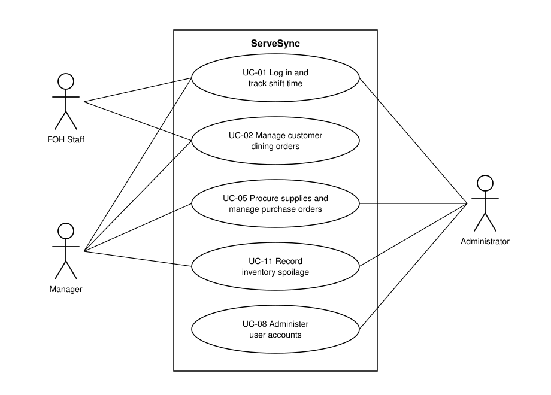

# ServeSync Sprint 4 — Sections 10 and 11 (short print version)

Section 10 was rewritten on 10 November 2026 to be as short as possible for printing: each test case is one table row instead of a seven-row table. All seven required fields are still present. Test Case ID, Test Inputs, Expected Results and Dependencies are columns; Initialization, Test Steps and Tear Down are the same for every case in a use case, so they are stated once above each table.

---

## 10.0 Testing

Testing is requirements-based: each test case is derived from a functional requirement and its use case in Section 5. Inputs were divided into equivalence classes (groups of values the system must treat the same way), and one value from each class was tested, plus the boundary values. Five major use cases were selected:

| Use Case | Name | Requirements |
| :--- | :--- | :--- |
| UC-01 | User Authentication & Shift Time Tracking | FR-2, FR-5 |
| UC-02 | Manage Customer Dining Orders | FR-9 |
| UC-05 | Procure Supplies & Manage Supplier Purchase Orders | FR-1 |
| UC-08 | Administer User Accounts & Security Settings | FR-2 |
| UC-11 | Record Inventory Spoilage | FR-6 |

Test Case IDs have the form *use case number.test number* (5.3 is the third test of UC-05). In the tables, V*n* is a valid equivalence class and I*n* is an invalid one.

## 10.1 Test Cases

### 10.1.1 Test Environment and Test Data

| Item | Value |
| :--- | :--- |
| Backend under test | ServeSync REST API (`backend/server.py`) on MySQL 8 |
| Application under test | ServeSync Flutter application, version 1.1.0 |
| Tools | `tests/run_section10_live.py` (sends each test case over HTTP), Python `unittest`, Flutter `flutter_test` |
| Employees (role, PIN) | Administrator 1234; Manager 2345; FOH Staff 3456, 4567, 5678 (demonstration accounts only) |
| Inventory | Item 1: 45 lbs in stock; item 2: 80 units in stock |
| Application data (UC-02) | Table 1 (2 seats); ServeSync Smash Burger $18.00; Crispy Calamari $15.50 |

**Fields that are the same for every test case**

| Field | Value |
| :--- | :--- |
| Initialization | A newly seeded test database. The user with the role named in the test is logged in. A case with a dependency starts from the state the earlier case left. |
| Test Steps | 1. Send the request (or perform the screen action) given under Test Inputs. 2. Read the status code and message. 3. Check the records named under Expected Results. |
| Tear Down | Log out, then delete the test database. |

### 10.1.2 UC-01 User Authentication & Shift Time Tracking

Interfaces: `POST /login`, `/logout`, `/clock-in`, `/clock-out`, `GET /me`.

| Input | Valid classes | Invalid classes |
| :--- | :--- | :--- |
| PIN format | V1: four digits | I1: under four digits; I2: over four; I3: has a non-digit; I4: empty |
| PIN owner | V2: Active employee | I5: no employee; I6: Inactive employee |
| Session at login | V3: none active | I7: already active |
| Failed attempts in 5 minutes | V4: 0 to 4 | I8: 5 or more |
| Shift at clock in / clock out | V5: none open / V6: open | I9: already open / I10: none open |
| Session token | V7: active session | I11: logged-out session |

| ID | Test Inputs | Expected Results | Depends on |
| :--- | :--- | :--- | :--- |
| 1.1 | PIN `1234` (V1–V4) | Login succeeds; token, user and role returned; shift status "not clocked in"; no Payroll record created. | — |
| 1.2 | PIN `9999` (I5) | 401 "Invalid Code"; no session created. | — |
| 1.3 | PINs `123`, `12345`, `12a4`, empty (I1–I4) | Each: 400 "PIN must contain exactly four digits." | — |
| 1.4 | PIN of a deactivated account (I6) | 401 "Invalid Code"; does not reveal that the account exists. | 8.6 |
| 1.5 | PIN `1234` again while logged in (I7) | 409 "Employee already has an active session…"; first session still valid. | 1.1 |
| 1.6 | Wrong PIN five times, then a valid PIN, same device (I8) | Attempts 1–5: 401. Attempt 6: 429 "Too many failed attempts. Wait five minutes." A different device can still log in. | — |
| 1.7 | Clock in (V5), then clock in again (I9) | First succeeds and creates one open Payroll record. Second: 409 "…Duplicate clock-in is prohibited." | 1.1 |
| 1.8 | Log out while clocked in; reuse old token (I11); log in again | Logout succeeds; shift stays open; old token: 401 "Please log in."; new login shows "clocked in". | 1.7 |
| 1.9 | Clock out (V6), then clock out again (I10) | First succeeds; hours and gross pay (hours × the employee's hourly rate) saved. Second: 400 "…does not have an active shift…" | 1.8 |

### 10.1.3 UC-02 Manage Customer Dining Orders

Interfaces: Floor Plan, Quick POS, order cart and Kitchen (KDS) screens; `POST /orders`, `POST /orders/{id}/complete`.

| Input | Valid classes | Invalid classes |
| :--- | :--- | :--- |
| Party size | V1: 1 to the table's capacity | I1: 0; I2: over capacity (the counter does not allow these) |
| Cart when sending | V2: one or more items | I3: empty |
| Item added | V3: same item, seat and modification (quantity rises); V4: different seat or modification (new line) | — |
| Seat | V5: Seat 1 to party size; V6: Shared | — |
| Ticket status | V7: New; V8: In Prep; V9: Ready | — |

| ID | Test Inputs | Expected Results | Depends on |
| :--- | :--- | :--- | :--- |
| 2.1 | Table 1, party of 2 (V1, upper boundary) | Table 1 becomes Seated with 2 guests and the server's name. | 1.1 |
| 2.2 | Table 1, empty cart (I3) | Send button cannot be used; no order or ticket created. | 2.1 |
| 2.3 | Smash Burger added twice for Seat 1 (V3) | One cart line, quantity 2, Seat 1. | 2.1 |
| 2.4 | Calamari for Seat 2; change its seat label (V4–V6) | Separate line; label cycles Seat 1, Seat 2, Shared, never above the party size. | 2.3 |
| 2.5 | Cart: 2 × burger, 1 × calamari | Subtotal $51.50; tax (8.25%) $4.25; total $55.75. | 2.4 |
| 2.6 | Send the cart for Table 1 (V2) | Cart emptied; Table 1 Ordered with bill $55.75; ticket under New Orders; order and its lines saved in Customer_Orders and Order_Items; stock reduced by recipe (beef −1.0 lb, buns −2, cheddar −0.3 lb, calamari −0.5 lb). | 2.5 |
| 2.7 | Advance the ticket (V7–V9) | New → In Prep → Ready → served and removed. | 2.6 |
| 2.8 | Clear Table 1 | Table Available, 0 guests, $0.00; the order is marked Completed. | 2.6 |

### 10.1.4 UC-05 Procure Supplies & Manage Supplier Purchase Orders

Interfaces: `POST /purchase-orders`, `POST /purchase-orders/{id}/receive`.

| Input | Valid classes | Invalid classes |
| :--- | :--- | :--- |
| User role | V1: Manager or Administrator | I1: FOH Staff |
| Supplier / order lines | V2: existing supplier; V3: one or more lines | I2: unknown supplier; I3: no lines |
| Inventory item / quantity / unit cost | V4: existing; V5: above 0; V6: 0 or more | I4: unknown; I5: 0; I6: negative; I7: negative cost |
| Quantity received | V7: below the outstanding balance; V8: equal to it (boundary) | I8: above it |
| Order status when receiving | V9: Pending or Partial | I9: Received |
| Request ID | V10: new | I10: missing; I11: already processed |
| Purchase order | V11: existing | I12: unknown |

| ID | Test Inputs | Expected Results | Depends on |
| :--- | :--- | :--- | :--- |
| 5.1 | Manager; supplier 1; 20 × item 1 at $2.50 and 10 × item 2 at $4.00 (V1–V6) | Order created, status Pending, total $90.00; stock unchanged. | 1.1 |
| 5.2 | No order lines (I3) | 400 "Supplier ID and at least one order line are required." | 1.1 |
| 5.3 | a) supplier 999 (I2); b) inventory item 999 (I4) | a) 404 "Supplier not found." b) 404 "Inventory item 999 not found." | 1.1 |
| 5.4 | Quantity 0, quantity −5, unit cost −1.00 (I5–I7) | Each: 400 "Invalid quantity or unit cost." | 1.1 |
| 5.5 | FOH Staff creates or receives an order (I1) | Both: 403 "Manager or Administrator access required." | 5.1 |
| 5.6 | Receive 12 of 20 on item 1, request ID `rcv-001` (V7, V10) | Status Partial; stock 45 → 57; one receipt and one audit record (+12). | 5.1 |
| 5.7 | Same request again, ID `rcv-001` (I11) | Accepted, nothing changes: stock stays 57, still one receipt. | 5.6 |
| 5.8 | Receive 9 when 8 are outstanding (I8, boundary + 1) | 400 "Received quantity (9) exceeds outstanding balance…"; stock stays 57. | 5.6 |
| 5.9 | Receive the remaining 8 and 10 (V8, boundary) | Status Received; item 1: 57 → 65; item 2: 80 → 90. | 5.8 |
| 5.10 | a) receive on a Received order (I9); b) no request ID (I10); c) order 999 (I12); d) no items | a) 400 "Cannot receive items…" b) 400 "Request ID is required…" c) 404 "Purchase order not found." d) 400 "No received items specified." | 5.9 |

### 10.1.5 UC-08 Administer User Accounts & Security Settings

Interfaces: `GET /users`, `POST /users`, `PATCH /users/{id}`, `DELETE /users/{id}`, `POST /users/{id}/end-session`.

| Input | Valid classes | Invalid classes |
| :--- | :--- | :--- |
| Role of requester | V1: Administrator | I1: Manager; I2: FOH Staff |
| Full name | V2: 1 to 100 characters | I3: blank; I4: 101 or more |
| Role assigned | V3: FOH Staff, Manager, Administrator | I5: anything else |
| PIN | V4: four digits, unused | I6: not four digits; I7: already assigned |
| Target account | V5: another existing account | I8: does not exist; I9: the administrator's own |

| ID | Test Inputs | Expected Results | Depends on |
| :--- | :--- | :--- | :--- |
| 8.1 | Administrator; name "Test Server"; FOH Staff; PIN `7777` (V1–V4) | Account created, Active; PIN not returned and stored only as a hash; the new employee can log in. | 1.1 |
| 8.2 | Name blank (I3); 101 characters (I4); 100 characters (V2, boundary) | First two: 400 "Name is required and must be at most 100 characters." Third accepted. | 1.1 |
| 8.3 | a) role "Chef" (I5); b) PIN `12` (I6) | a) 400 "Invalid role." b) 400 "PIN must contain exactly four digits." | 1.1 |
| 8.4 | PIN `2345`, already assigned (I7) | 409 "PIN is already assigned. Choose another PIN." | 1.1 |
| 8.5 | Manager, then FOH Staff, lists and creates users (I1, I2) | All four: 403 "Administrator access is required." | 1.1 |
| 8.6 | Deactivate a logged-in employee, then reactivate (V5) | Status Inactive, record kept; their token and PIN are rejected (401); after reactivation they can log in. | 1.1 |
| 8.7 | Administrator deactivates or demotes own account (I9) | Both: 409 "You cannot deactivate or demote your own administrator account." | 1.1 |
| 8.8 | Reset an employee's PIN to `8888` | Their session ends; old PIN rejected; new PIN works. | 1.1 |
| 8.9 | End another employee's session | "Session revoked."; their token is rejected; they can log in again. | 1.1 |
| 8.10 | User ID 9999 (I8) | 404 "User not found." | 1.1 |

### 10.1.6 UC-11 Record Inventory Spoilage

Interfaces: `POST /inventory/spoilage`, `GET /inventory`.

| Input | Valid classes | Invalid classes |
| :--- | :--- | :--- |
| User role | V1: Manager or Administrator | I1: FOH Staff |
| Inventory item | V2: existing | I2: unknown |
| Quantity spoiled | V3: above 0 and below stock; V4: equal to stock (boundary) | I3: 0; I4: negative; I5: above stock (stock + 0.01) |
| Reason | V5: not blank | I6: blank |
| Request ID | V6: new | I7: missing; I8: already processed |

| ID | Test Inputs | Expected Results | Depends on |
| :--- | :--- | :--- | :--- |
| 11.1 | Manager; item 1; quantity 5; reason "Expired"; ID `spl-001` (V1–V3, V5, V6) | Stock 45 → 40; spoilage record (before 45, after 40) and audit record (−5) created. | 1.1 |
| 11.2 | Quantity 0 and −3 (I3, I4) | Both: 400 "Inventory item ID, positive quantity, and reason are required." | 11.1 |
| 11.3 | Quantity 40.01 with 40 in stock (I5, boundary) | 400 "Spoiled quantity (40.01) exceeds available stock…"; stock stays 40. | 11.1 |
| 11.4 | Blank reason (I6) | 400, same message as 11.2; stock unchanged. | 11.1 |
| 11.5 | Inventory item 999 (I2) | 404 "Inventory item not found." | 1.1 |
| 11.6 | Same request as 11.1, ID `spl-001` again (I8) | Accepted and returns the original record; stock is not reduced again. | 11.1 |
| 11.7 | FOH Staff (I1) | 403 "Manager or Administrator access required." | 1.1 |
| 11.8 | No request ID (I7) | 400 "Request ID is required for idempotent spoilage processing." | 1.1 |
| 11.9 | Quantity 40 with 40 in stock (V4, boundary) | Succeeds; stock becomes 0. | 11.1 |

### 10.1.7 Requirements Traceability

Use the last column for the "Test cases:" line under each requirement in Section 5. Entries beginning with T are automated tests in `tests/test_sprint4_features.py` (T02 is `test_02_…`).

| Requirement | Use Case | Test cases |
| :--- | :--- | :--- |
| FR-1 Incoming inventory and supplier management | UC-05 | 5.1 – 5.10, T13, T14 |
| FR-2 User management and authentication | UC-01, UC-08 | 1.1 – 1.6, 8.1 – 8.10 |
| FR-3 Supply database and access permissions | UC-04 | 5.5, 11.7, T15 |
| FR-4 Payroll management | UC-09 | T16 |
| FR-5 Employee management and time tracking | UC-01 | 1.7 – 1.9, T16 |
| FR-6 Spoilage tracking | UC-11 | 11.1 – 11.9 |
| FR-7 Reservation management | UC-03 | T02 – T05 |
| FR-8 AI-powered review summaries | UC-07 | T08 – T10 |
| FR-9 Customer order management | UC-02 | 2.1 – 2.8, T06, T07, T19 |
| FR-10 AI-powered consumption analytics | UC-06 | T11, T12 |
| FR-11 Customer service administration | UC-12 | T18 |
| FR-12 Applications, hiring, and onboarding | UC-10 | T17 |

### 10.1.8 Test Execution Summary

| Test cases | How they were run | Date | Result |
| :--- | :--- | :--- | :--- |
| 1.1 – 1.9, 5.1 – 5.10, 8.1 – 8.10, 11.1 – 11.9 (38 cases) | `tests/run_section10_live.py`, over HTTP, against the API on a MySQL 8 test database built from the production schema | 10 Nov 2026 | 38 passed (132 of 132 checks) |
| 2.1 – 2.8 | By hand in the web application (Floor Plan, Quick POS, order cart, Kitchen screens) connected to the same test API; saved records checked through the API | 10 Nov 2026 | 8 passed |
| T02 – T19 | `tests/test_sprint4_features.py` (Python `unittest`) | 10 Nov 2026 | 19 passed |

The test script uses the stock quantities it finds in the database and checks the same changes (+12, +8, −5 and so on), so its starting figures differ from the 45 and 80 shown in the tables. Known limitation found during testing: a delivery line with a received quantity of 0 is ignored, but an empty receipt record is still saved (UC-05, low impact).

## 10.2 Testing (JUnit)

JUnit is the xUnit framework for Java. ServeSync is written in Python (backend) and Dart (application), so the equivalent xUnit frameworks are used: Python `unittest` and Flutter `flutter_test`.

| JUnit | Python `unittest` | `flutter_test` |
| :--- | :--- | :--- |
| Test class / `@Test` method | `unittest.TestCase` class / `test_…` method | `group(...)` / `test(...)` |
| `@BeforeEach` / `@AfterEach` | `setUp()` / `tearDown()` | `setUp(...)` / `tearDown(...)` |
| `assertEquals` / `assertThrows` | `assertEqual` / `assertRaises` | `expect(actual, expected)` / `throwsA(...)` |

| Test file | Tests | What it covers | Result, 10 Nov 2026 |
| :--- | :--- | :--- | :--- |
| `tests/test_sprint4_features.py` | 19 | Reservations, orders, kitchen tickets, reviews and summary, consumption forecast, suppliers, inventory, payroll, hiring, service issues | 19 passed |
| `tests/test_sprint3_backend.py` | 5 | Login and shifts, purchase orders, spoilage, role restrictions | 5 passed |
| `mobile/test/` | 20 | API client (login, token, error handling, offline mode); the Manage screens (reservations, customer service, suppliers, user accounts, payroll, hiring); inventory changes; application start | 20 passed |

Example: the double-booking rule of UC-03 written as an automated test. `setUp()` is the Initialization field and `tearDown()` is the Tear Down field.

```python
class Sprint4FeatureTests(unittest.TestCase):
    def setUp(self):                                   # Initialization
        seed_sqlite(self.tmp.name)
        self.svc = Service(Database(self.tmp.name), SECRET)

    def tearDown(self):                                # Tear Down
        os.unlink(self.tmp.name)

    def test_04_reservation_double_booking_is_rejected(self):
        self.call('POST', '/reservations', self.booking())          # 18:00, table 2
        message = self.fails(409, 'POST', '/reservations',
                             self.booking(reservation_time='19:00'))
        self.assertIn('already reserved', message)
```

---


## 11.0 Architectural Modeling

The architecture of ServeSync is described using the 4+1 view model. The model describes one system from four viewpoints, each aimed at a different reader, and ties them together with a small set of use case scenarios.

| View | Question it answers | Main reader | Diagram used |
| :--- | :--- | :--- | :--- |
| Logical view | What are the main parts of the system and what does each one do? | End users, analysts | Layer and class diagram |
| Development view | How is the source code organised? | Programmers | Package (component) diagram |
| Process view | What happens at run time, and in what order? | System integrators, testers | Sequence diagrams |
| Physical view | What hardware and hosting does the software run on? | System and operations engineers | Deployment diagram |
| Scenarios (+1) | Which use cases show that the four views work together? | Everyone | Use case diagram |

### 11.1 Selected Architectural Model

**Selected model: Layered Architecture.** ServeSync is organised into four layers. Each layer uses only the services of the layer directly below it. The layers are deployed across a client and a server, so in the physical view the same design appears as a three-tier client–server system (application, API server, database).

| Layer | Contents | Responsibility |
| :--- | :--- | :--- |
| 1. Presentation | Flutter screens (PIN keypad, Floor Plan, Quick POS, Kitchen display, Inventory, Shifts) | Shows information to staff and collects their input. Contains no business rules. |
| 2. Application | `AppState`, `ApiClient`, and the model classes | Holds the current state of the application, applies client-side rules (cart totals, seat assignment), and sends requests to the server. |
| 3. Business logic (service) | REST API: HTTP handler and `Service` class | Authenticates the employee, checks the employee's role, validates input, and applies the business rules. |
| 4. Data | `Database` and `Query` classes, MySQL database | Stores data and guarantees that each operation is saved completely or not at all. |

The layered model is the most appropriate for ServeSync for these reasons:

- **Security.** Sensitive rules (PIN checking, role permissions, stock changes) sit in the service layer on the server, where the application cannot bypass them. The application never connects to the database directly.
- **Changeability.** A layer can be replaced without changing the others. This has already happened in the project: the original Swift application was replaced by a Flutter application without changing the API or the database, and the database was moved to Railway MySQL without changing the application.
- **Testability.** Each layer can be tested on its own. The service layer is tested against a temporary test database, and the application's API client is tested against a simulated server (Section 10).
- **Several kinds of client.** The same API serves the web application, the Android application, and the iOS application.

Other models were considered and not selected:

| Model | Why it was not selected |
| :--- | :--- |
| Model–View–Controller (MVC) | MVC describes how a user interface is organised. The Flutter application follows it internally (screens are views, `AppState` is the model and controller), but it does not describe the server or the database. |
| Repository | All data is held in one database, but the parts of the system do not communicate through it. They communicate through the API. |
| Client–server | ServeSync is client–server in its deployment, and this is shown in the physical view. On its own it does not describe how responsibilities are divided inside the client and the server. |
| Pipe and filter | This model suits systems that transform a stream of data in stages. ServeSync is interactive and transaction-based. |

The main disadvantage of the layered model is that a request passes through every layer, which adds a small delay. This is acceptable for ServeSync, where requests are small and a response within a few seconds is sufficient.

### 11.2 Logical View

The logical view shows the functional parts of the system as layers and the main classes in each layer.



The main subsystems seen by users are:

| Subsystem | Classes | Use cases |
| :--- | :--- | :--- |
| Authentication and shifts | PinKeypadScreen, ShiftsScreen, AppState, Service (login, clock_in, clock_out) | UC-01 |
| Dining and orders | FloorPlanScreen, QuickPOSScreen, OrderCartSheet, KDSScreen, AppState, Feature routes (orders, kitchen tickets) | UC-02 |
| Reservations | ReservationsScreen, Feature routes (reservations) | UC-03 |
| Reviews and analytics | AIInsightsSheet, Feature routes, Insights | UC-06, UC-07 |
| Inventory and spoilage | InventorySpoilageScreen, AppState, Service (record_spoilage) | UC-04, UC-11 |
| Purchasing | InventorySpoilageScreen, AppState, Service (create_purchase_order, receive_delivery) | UC-05 |
| Administration | UserAccountsScreen, PayrollScreen, HiringScreen, CustomerServiceScreen, Service (user accounts), Feature routes (payroll, hiring, service issues) | UC-08, UC-09, UC-10, UC-12 |

Every function passes through all four layers. Customer orders are sent to the API and saved in MySQL, where the stock they use is deducted. The kitchen display on each device reads the open kitchen tickets from the API every five seconds, so all devices show the same queue. No other data service is used.

### 11.3 Development View

The development view shows how the source code is organised in the GitHub repository and which packages depend on which.



| Package | Language | Purpose |
| :--- | :--- | :--- |
| `mobile/lib/screens` | Dart | One folder for each screen of the application |
| `mobile/lib/services` | Dart | Application state and the client for the REST API |
| `mobile/lib/models` | Dart | Data classes used by the screens |
| `mobile/lib/theme` | Dart | Colour themes |
| `backend` | Python | REST API server, business rules, review and stock analysis, and the database schema with its updates |
| `database` | Python, SQL | Seed data for testing and demonstration |
| `tests`, `mobile/test` | Python, Dart | Automated tests |
| `.github/workflows` | YAML | Automated build of the Android application and deployment of the web application |

The application and the backend are developed and released separately. Their only connection is the REST API, so a change inside one does not require a change in the other as long as the API stays the same.

### 11.4 Process View

The process view shows what runs at the same time and how the parts communicate while the system is in use.

| Process | Where it runs | Concurrency |
| :--- | :--- | :--- |
| ServeSync application | Each staff device (browser, Android, iOS) | One user-interface thread. Network requests are asynchronous, so the screen stays responsive while waiting for the server. A timer asks the API for the open kitchen tickets every five seconds, so every device shows the same kitchen queue. |
| API server | Railway | One Python process. Each incoming request is handled on its own thread, so several staff can use the system at once. |
| MySQL server | Railway | Each request runs in its own transaction. Rows that are being changed are locked, so two requests cannot change the same stock quantity at the same time. |

If the API server cannot be reached, or it reports a server fault, the application switches to an offline demonstration mode with built-in data and shows a notice. A wrong PIN or a permission error is not treated as an outage; the server's message is shown to the user.

**Sequence diagram 1 — Log in and clock in (UC-01)**



**Sequence diagram 2 — Record inventory spoilage (UC-11)**



The two diagrams show the two rules that protect the data when several staff work at once. First, each request is one database transaction, so a failure part-way through leaves no partial change. Second, the row lock and the unique request ID together guarantee that stock is deducted exactly once, even if two managers submit at the same moment or the same request is sent twice.

### 11.5 Physical View

The physical view shows the hardware and hosting services that the software runs on and how they are connected.



| Node | Software | Connection |
| :--- | :--- | :--- |
| Staff device | ServeSync application (web, Android, or iOS) | Internet (HTTPS) |
| GitHub Pages | The web build of the application (static files) | HTTPS |
| GitHub Releases | The Android installation file (APK) | HTTPS |
| GitHub Actions | Builds the application and deploys it whenever code is pushed to the main branch | — |
| Railway API service | Python REST API | HTTPS from devices; private network to the database |
| Railway MySQL service | MySQL 8 database | Reachable only from the API service |

In Sprint 3 the demonstration ran on one computer. The system is now hosted in the cloud: the application is served from GitHub Pages, the API and the database run on Railway, and no part of the system needs to run on a team member's computer.

### 11.6 Scenarios (Use Case View)

The scenarios are the "+1" view. They are the five use cases tested in Section 10. Each one passes through all four views, which shows that the views describe the same system.



Actors are drawn as stick figures outside the system boundary, and each oval is one use case.

| Scenario | Logical view | Development view | Process view | Physical view |
| :--- | :--- | :--- | :--- | :--- |
| UC-01: An employee logs in and clocks in | PinKeypadScreen, ShiftsScreen → AppState → ApiClient → Service → Users, Sessions, Payroll | `screens/auth`, `screens/shifts`, `services`, `backend/service.py` | Sequence diagram 1 | Device → Railway API → Railway MySQL |
| UC-02: A server seats a party and sends an order to the kitchen | FloorPlanScreen, QuickPOSScreen, OrderCartSheet, KDSScreen → AppState → ApiClient → Feature routes → Customer_Orders, Order_Items, Inventory | `screens/floor_plan`, `screens/pos`, `screens/kds`, `services`, `backend/features.py` | The order is saved in one transaction; every device reads the kitchen tickets from the API every five seconds | Device → Railway API → Railway MySQL |
| UC-05: A manager orders stock and receives the delivery | InventorySpoilageScreen → AppState → ApiClient → Service → Supplier_Orders, Supplier_Order_Items, Delivery_Receipts, Inventory | `screens/inventory`, `services`, `backend/service.py` | One transaction per request; the order row is locked while a delivery is recorded; request ID prevents double receiving | Device → Railway API → Railway MySQL |
| UC-08: An administrator creates or deactivates an account | Service (user accounts) → Users, Sessions | `backend/service.py` | One transaction per request; User_Management_Lock prevents two account changes at once | API client → Railway API → Railway MySQL |
| UC-11: A manager records spoiled stock | InventorySpoilageScreen → AppState → ApiClient → Service → Inventory, Inventory_Spoilage, Inventory_Transactions | `screens/inventory`, `services`, `backend/service.py` | Sequence diagram 2 | Device → Railway API → Railway MySQL |
