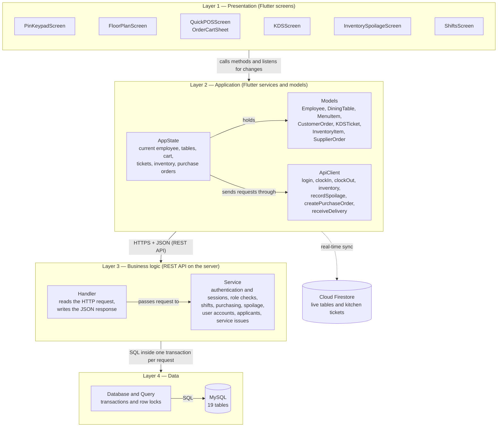
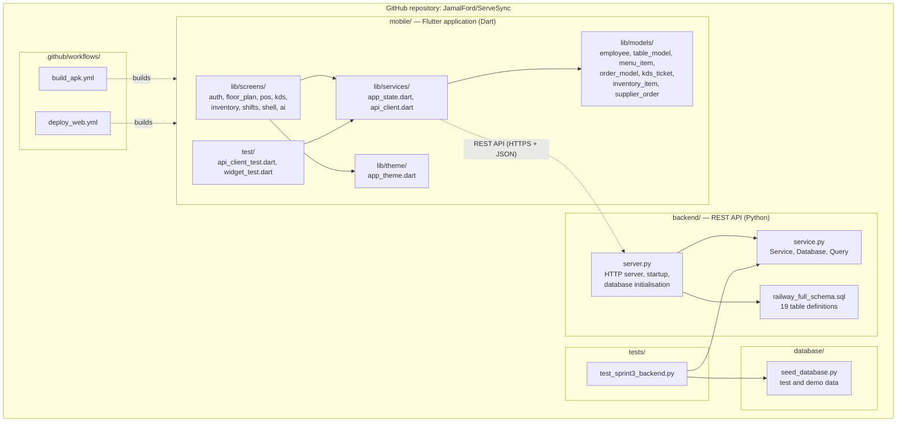
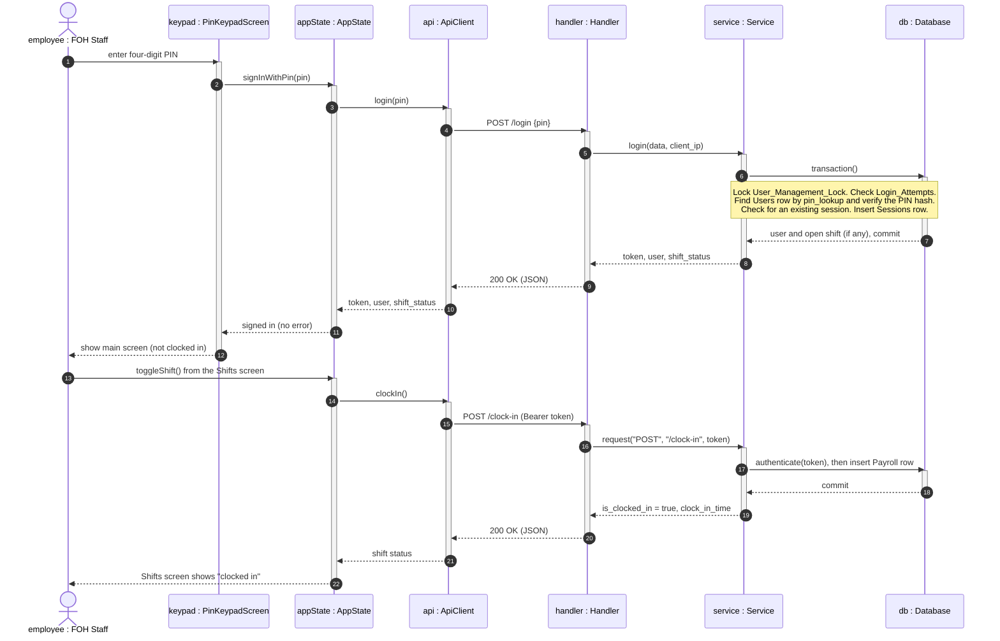
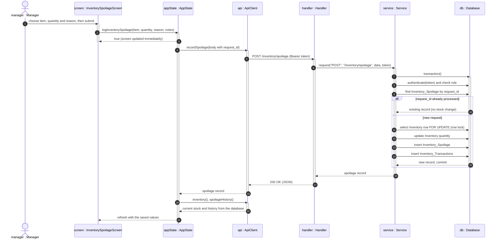
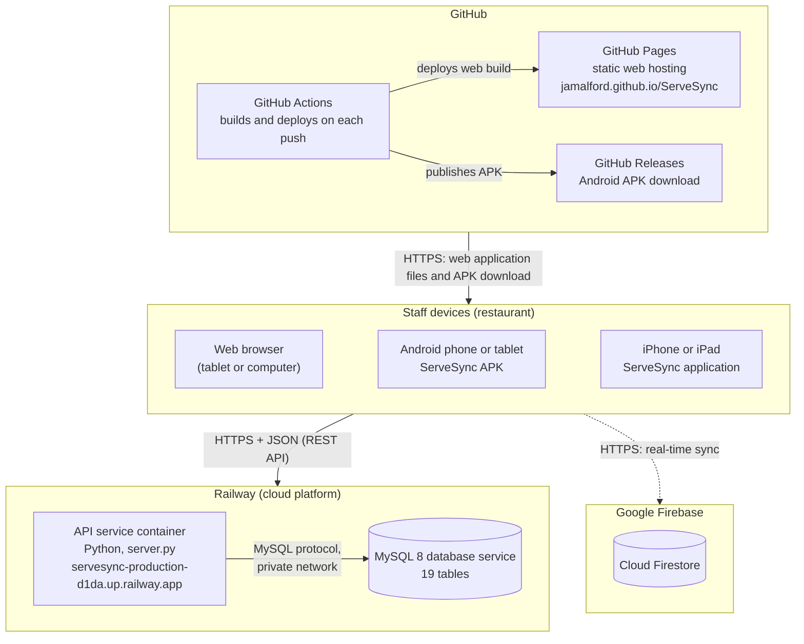

# ServeSync Sprint 4 — Sections 10 and 11 (draft)

This file is a draft of Section 10 (Testing, 10.1 Test Cases, 10.2 Testing with JUnit) and Section 11 (Architectural Modeling) written in the style of the Sprint 3 document. Paste the sections into the Sprint 4 document and redraw or screenshot the diagrams.

**What was actually run before writing this (read this first):**

- Every backend test case below (use cases 1, 5, 8 and 11) was executed on 9 November 2026 against the ServeSync service layer on a fresh test database built by `database/seed_database.py`. 58 of 59 checks matched. The one mismatch was a number-format difference in my own check script (`90.0` against `90.00`), not a product fault.
- The backend cases were run by calling the service directly, not by sending HTTP requests, and not against the live Railway database. Success responses are returned by the HTTP layer as status 200; that was read from the code, not observed over the network.
- The use case 2 cases (orders) were verified by a script that drives the app's state class (`AppState`). Nobody has clicked through them by hand in the app yet. The steps are written as screen actions so the team can do that.
- The "Result" column in 10.1.9 records those runs. If the team reruns the cases by hand on the live site, replace the dates and results with your own.

---

## 10.0 Testing

Testing in this sprint is requirements-based. Each test case is derived from a functional requirement and its use case in Section 5, and checks that the system does what the requirement says for valid input and refuses invalid input with a clear message. The five major use cases selected for testing are the ones that are implemented end to end, or that carry the most important business rules:

| Use Case | Name | Requirement | Why it was selected |
| :--- | :--- | :--- | :--- |
| UC-01 | User Authentication & Shift Time Tracking | FR-2, FR-5 | Every other function depends on login. It also carries the client's rule that logging in and clocking in are separate. |
| UC-02 | Manage Customer Dining Orders | FR-9 | The main front-of-house workflow: seat a party, take an order by seat, send it to the kitchen. |
| UC-05 | Procure Supplies & Manage Supplier Purchase Orders | FR-1 | Changes stock and money values across four tables in one transaction. |
| UC-08 | Administer User Accounts & Security Settings | FR-2 | Controls who can access the system; contains the role-based access rules. |
| UC-11 | Record Inventory Spoilage | FR-6 | Deducts stock and must never deduct twice or go below zero. |

The inputs of each use case were divided into equivalence classes. An equivalence class is a group of input values that the system should treat in the same way, so one test value from each class is enough to represent the whole class. Values at the edges of a class (boundary values), such as a quantity exactly equal to the stock on hand, were tested as well, because errors are most likely there.

Each test case is recorded with the following fields: Test Case ID, Test Inputs, Expected Results, Dependencies, Initialization, Test Steps, and Tear Down. Test Case IDs have the form *use case number.test number*. For example, test case 5.3 is the third test of UC-05.

## 10.1 Test Cases

### 10.1.1 Features to Be Tested

| Use Case | Features tested |
| :--- | :--- |
| UC-01 | PIN format validation; login with a valid, unknown, or deactivated PIN; one session per employee; lockout after repeated failures; clock in; duplicate clock-in prevention; logout that leaves the shift open; clock out and pay calculation |
| UC-02 | Seating a party at a table; adding items to an order by seat; merging and separating order lines; subtotal, tax, and total calculation; sending an order to the kitchen; inventory deduction; kitchen ticket progression; clearing a table |
| UC-05 | Creating a purchase order; validation of supplier, items, quantities, and costs; role restriction; partial and full delivery receiving; over-receipt prevention; duplicate submission protection; order status changes |
| UC-08 | Creating an account; validation of name, role, and PIN; unique PINs; administrator-only access; deactivation and reactivation; PIN reset; ending another employee's session; protection of the administrator's own account |
| UC-11 | Recording spoilage; validation of quantity, reason, and item; stock deduction and audit record; prevention of deducting more than the stock on hand; duplicate submission protection; role restriction |

### 10.1.2 Test Environment and Test Data

| Item | Value |
| :--- | :--- |
| Backend under test | ServeSync REST API service (`backend/service.py`) |
| Test database | A new, empty database created for each test run and filled by `database/seed_database.py` |
| Application under test (UC-02) | ServeSync Flutter application, version 1.1.0 |
| Tools | Python `unittest`, Flutter `flutter_test` |

Seeded test data used by the test cases:

| Data | Values |
| :--- | :--- |
| Employees (name, role, PIN) | Salem Marye, Administrator, 1234; Kristian Napier, Manager, 2345; Jamal Ford, FOH Staff, 3456; Sneha Patel, FOH Staff, 4567; Mason Mathias, FOH Staff, 5678 |
| Inventory | Item 1: Vine Tomatoes, 45 lbs; Item 2: Angus Beef Patties, 80 units |
| Suppliers | Supplier 1: Metro Farm Produce Co. |
| Purchase orders | Order 1: Pending, 50 × item 1 at $2.50 (sample order; not used by the tests) |
| Dining tables (application) | Table 1: 2 seats, Available |
| Menu items (application) | ServeSync Smash Burger $18.00; Crispy Calamari $15.50 |
| Application stock before UC-02 tests | Ground beef 38.5 lbs; brioche buns 56; cheddar 14; calamari 12 |

The PINs above are test values that exist only in the seeded test database.

---

### 10.1.3 Test Specification — UC-01 User Authentication & Shift Time Tracking

| Item | Description |
| :--- | :--- |
| Use case | **UC-01 User Authentication & Shift Time Tracking** |
| Requirements | FR-2 (User management and authentication), FR-5 (Employee management and time tracking) |
| Objective | Verify that only an active employee with a correct four-digit PIN can log in, that repeated wrong PINs are locked out, and that clocking in and out is separate from logging in and out. |
| Interfaces | `POST /login`, `POST /logout`, `GET /me`, `POST /clock-in`, `POST /clock-out`; in the application: the PIN keypad screen and the Shifts tab |
| Pass criteria | Every expected result is observed, and no session or shift record is created by a rejected request. |

**Equivalence classes**

| Input | Valid classes | Invalid classes |
| :--- | :--- | :--- |
| PIN format | V1: exactly four digits | I1: fewer than four digits; I2: more than four digits; I3: contains a non-digit; I4: empty |
| PIN owner | V2: belongs to an Active employee | I5: belongs to no employee; I6: belongs to an Inactive employee |
| Session state at login | V3: employee has no active session | I7: employee already has an active session |
| Failed attempts from the same device in 5 minutes | V4: 0 to 4 | I8: 5 or more |
| Shift state at clock in | V5: no open shift | I9: a shift is already open |
| Shift state at clock out | V6: a shift is open | I10: no open shift |
| Session token | V7: token of an active session | I11: token of a session that was logged out |

**Test cases**

| Field | Test Case 1.1 — Log in with a valid PIN |
| :--- | :--- |
| Test Case ID | 1.1 |
| Test Inputs | PIN `1234` (classes V1, V2, V3, V4) |
| Expected Results | Login succeeds. The response contains a session token, the user Salem Marye with role Administrator, and a shift status of "not clocked in". One Sessions record exists for the user. No Payroll record is created. |
| Dependencies | None |
| Initialization | Fresh seeded test database. No active sessions. |
| Test Steps | 1. Send `POST /login` with body `{"pin": "1234"}`.<br>2. Read the response.<br>3. Count the Sessions records for the user and the Payroll records for the user. |
| Tear Down | Send `POST /logout` with the token. Delete the test database. |

| Field | Test Case 1.2 — Log in with an unknown PIN |
| :--- | :--- |
| Test Case ID | 1.2 |
| Test Inputs | PIN `9999` (class I5) |
| Expected Results | Request is rejected with status 401 and the message "Invalid Code". No Sessions record and no Payroll record are created. |
| Dependencies | None |
| Initialization | Fresh seeded test database. No employee has the PIN 9999. |
| Test Steps | 1. Send `POST /login` with body `{"pin": "9999"}`.<br>2. Read the response.<br>3. Count the Sessions and Payroll records. |
| Tear Down | Delete the test database (this also clears the failed-attempt counter). |

| Field | Test Case 1.3 — Log in with a badly formatted PIN |
| :--- | :--- |
| Test Case ID | 1.3 |
| Test Inputs | a) `123` (I1); b) `12345` (I2); c) `12a4` (I3); d) empty text (I4) |
| Expected Results | Each request is rejected with status 400 and the message "PIN must contain exactly four digits." No Sessions record is created. |
| Dependencies | None |
| Initialization | Fresh seeded test database. |
| Test Steps | 1. Send `POST /login` with input a.<br>2. Read the response.<br>3. Repeat steps 1 and 2 for inputs b, c, and d. |
| Tear Down | Delete the test database. |

| Field | Test Case 1.4 — Log in to a deactivated account |
| :--- | :--- |
| Test Case ID | 1.4 |
| Test Inputs | PIN `5678`, belonging to an account whose status is Inactive (class I6) |
| Expected Results | Request is rejected with status 401 and the message "Invalid Code". The response does not reveal that the account exists. |
| Dependencies | Test case 8.6 (deactivating an account) |
| Initialization | Fresh seeded test database. The administrator has deactivated Mason Mathias. |
| Test Steps | 1. Send `POST /login` with body `{"pin": "5678"}`.<br>2. Read the response. |
| Tear Down | Delete the test database. |

| Field | Test Case 1.5 — Second login while a session is active |
| :--- | :--- |
| Test Case ID | 1.5 |
| Test Inputs | PIN `1234`, sent a second time while the first session is still active (class I7) |
| Expected Results | The second request is rejected with status 409 and the message "Employee already has an active session. Log out on that device or ask an administrator to end the session." The first session remains valid. |
| Dependencies | Test case 1.1 |
| Initialization | Fresh seeded test database. Salem Marye is logged in (test case 1.1) and has not logged out. |
| Test Steps | 1. Send `POST /login` with body `{"pin": "1234"}` again.<br>2. Read the response.<br>3. Send `GET /me` with the first token and confirm it is still accepted. |
| Tear Down | Send `POST /logout` with the first token. Delete the test database. |

| Field | Test Case 1.6 — Lockout after five failed attempts |
| :--- | :--- |
| Test Case ID | 1.6 |
| Test Inputs | PIN `9999` five times, then PIN `2345` (a valid PIN), all from the same device (class I8). Then PIN `2345` from a different device (class V4). |
| Expected Results | Attempts 1 to 5 are rejected with status 401. The sixth attempt is rejected with status 429 and the message "Too many failed attempts. Wait five minutes.", even though the PIN is valid. The login from the different device succeeds. |
| Dependencies | None |
| Initialization | Fresh seeded test database. No failed attempts recorded. |
| Test Steps | 1. Send `POST /login` with `{"pin": "9999"}` five times from device A.<br>2. Send `POST /login` with `{"pin": "2345"}` from device A.<br>3. Read the response.<br>4. Send `POST /login` with `{"pin": "2345"}` from device B.<br>5. Read the response. |
| Tear Down | Log out the device B session. Delete the test database (or wait five minutes for the lockout to end). |

| Field | Test Case 1.7 — Clock in, and duplicate clock-in |
| :--- | :--- |
| Test Case ID | 1.7 |
| Test Inputs | Clock-in request from a logged-in employee with no open shift (V5), followed by a second clock-in request (I9) |
| Expected Results | The first request succeeds and returns "clocked in" with the clock-in time. A Payroll record is created with an empty clock-out time and payment status Pending. The second request is rejected with status 409 and the message "Employee already has an active shift. Duplicate clock-in is prohibited." Only one Payroll record exists. |
| Dependencies | Test case 1.1 |
| Initialization | Fresh seeded test database. Salem Marye is logged in and is not clocked in. |
| Test Steps | 1. Send `POST /clock-in` with the session token.<br>2. Read the response and check the Payroll table.<br>3. Send `POST /clock-in` again.<br>4. Read the response and count the Payroll records. |
| Tear Down | Leave the shift open for test case 1.8. |

| Field | Test Case 1.8 — Logging out does not end the shift |
| :--- | :--- |
| Test Case ID | 1.8 |
| Test Inputs | Logout request from an employee who is clocked in; the old token (I11); PIN `1234` to log in again |
| Expected Results | Logout succeeds with the message "Logged out of session. Active shifts remain open." The Payroll record still has an empty clock-out time. A request with the old token is rejected with status 401 and the message "Please log in." After logging in again, the shift status is "clocked in". |
| Dependencies | Test case 1.7 |
| Initialization | Salem Marye is logged in and clocked in (state left by test case 1.7). |
| Test Steps | 1. Send `POST /logout` with the session token.<br>2. Check the Payroll record.<br>3. Send `GET /me` with the old token and read the response.<br>4. Send `POST /login` with `{"pin": "1234"}`.<br>5. Read the shift status in the response. |
| Tear Down | Leave the new session and the open shift for test case 1.9. |

| Field | Test Case 1.9 — Clock out, and clock out with no open shift |
| :--- | :--- |
| Test Case ID | 1.9 |
| Test Inputs | Clock-out request with an open shift (V6), followed by a second clock-out request (I10) |
| Expected Results | The first request succeeds and returns "not clocked in". The Payroll record now has a clock-out time, hours worked, and gross pay equal to hours worked × hourly rate; payment status is Pending. The second request is rejected with status 400 and the message "Employee does not have an active shift to clock out from." |
| Dependencies | Test case 1.8 |
| Initialization | Salem Marye is logged in and clocked in (state left by test case 1.8). |
| Test Steps | 1. Send `POST /clock-out` with the session token.<br>2. Read the response and check the Payroll record.<br>3. Send `POST /clock-out` again.<br>4. Read the response. |
| Tear Down | Send `POST /logout`. Delete the test database. |

---

### 10.1.4 Test Specification — UC-02 Manage Customer Dining Orders

| Item | Description |
| :--- | :--- |
| Use case | **UC-02 Manage Customer Dining Orders** |
| Requirements | FR-9 (Customer order management) |
| Objective | Verify that a server can seat a party, build an order by seat, see correct totals, and send the order to the kitchen, and that the table, the kitchen display, and inventory are updated. |
| Interfaces | ServeSync application: Floor Plan tab, Quick POS tab, order cart, Kitchen (KDS) tab |
| Pass criteria | Every expected result is observed on screen, and an order with no items cannot be sent. |

**Equivalence classes**

| Input | Valid classes | Invalid classes |
| :--- | :--- | :--- |
| Party size | V1: from 1 up to the table's capacity (boundaries: 1 and the capacity) | I1: 0 or less; I2: more than the capacity. The party counter on screen does not allow these values. |
| Cart contents when sending | V2: one or more items | I3: empty cart |
| Item added to the cart | V3: same item, same seat, same modification as an existing line (quantity increases); V4: different seat or different modification (new line) | — |
| Seat assignment | V5: Seat 1 to Seat N, where N is the party size; V6: Shared | — |
| Kitchen ticket status | V7: New; V8: In Prep; V9: Ready | — |

**Test cases**

| Field | Test Case 2.1 — Seat a party at a table |
| :--- | :--- |
| Test Case ID | 2.1 |
| Test Inputs | Table 1 (2 seats); party size 2 (class V1, upper boundary) |
| Expected Results | Table 1 changes from Available to Seated, shows 2 guests, and shows the logged-in employee as the server. |
| Dependencies | Test case 1.1 (the employee must be logged in) |
| Initialization | Application started and logged in. Table 1 is Available. |
| Test Steps | 1. Open the Floor Plan tab.<br>2. Select Table 1.<br>3. Use the − and + buttons to set the party size to 2.<br>4. Select "Seat Party (2 Guests)".<br>5. Observe Table 1 on the floor plan. |
| Tear Down | None. Table 1 stays seated for the next test cases. |

| Field | Test Case 2.2 — An empty order cannot be sent |
| :--- | :--- |
| Test Case ID | 2.2 |
| Test Inputs | Table 1; empty cart (class I3) |
| Expected Results | The "Send Order to Kitchen (KDS)" button cannot be used. No order and no kitchen ticket are created. Table 1 remains Seated. |
| Dependencies | Test case 2.1 |
| Initialization | Table 1 is Seated. The cart is empty. |
| Test Steps | 1. From Table 1, select "Open POS Order".<br>2. Open the cart without adding any item.<br>3. Try to select "Send Order to Kitchen (KDS)".<br>4. Open the Kitchen (KDS) tab and confirm no new ticket appears. |
| Tear Down | None |

| Field | Test Case 2.3 — Adding the same item twice to the same seat |
| :--- | :--- |
| Test Case ID | 2.3 |
| Test Inputs | ServeSync Smash Burger added twice, both for Seat 1, no modifications (class V3) |
| Expected Results | The cart shows one line for the Smash Burger with quantity 2 and seat label Seat 1. |
| Dependencies | Test case 2.1 |
| Initialization | Table 1 is Seated with 2 guests. The cart is empty. |
| Test Steps | 1. In Quick POS, select ServeSync Smash Burger.<br>2. Select ServeSync Smash Burger again.<br>3. Open the cart and read the lines. |
| Tear Down | None. The cart is kept for the next test cases. |

| Field | Test Case 2.4 — Same item for a different seat |
| :--- | :--- |
| Test Case ID | 2.4 |
| Test Inputs | Crispy Calamari for Seat 2; then the seat label of that line changed (classes V4, V5, V6) |
| Expected Results | The calamari appears as a separate line from the burgers. Tapping the seat label moves through Seat 1, Seat 2, and SHARED, and never offers a seat number above the party size (2). |
| Dependencies | Test case 2.3 |
| Initialization | The cart contains 2 × Smash Burger for Seat 1. |
| Test Steps | 1. In Quick POS, select Crispy Calamari.<br>2. Open the cart.<br>3. Tap the seat label on the calamari line until it shows Seat 2.<br>4. Keep tapping and note each value shown, then return it to Seat 2. |
| Tear Down | None |

| Field | Test Case 2.5 — Subtotal, tax, and total |
| :--- | :--- |
| Test Case ID | 2.5 |
| Test Inputs | Cart: 2 × ServeSync Smash Burger at $18.00 and 1 × Crispy Calamari at $15.50 |
| Expected Results | Subtotal $51.50. Tax (8.25%) $4.25. Total $55.75. |
| Dependencies | Test cases 2.3 and 2.4 |
| Initialization | The cart contains the items from test cases 2.3 and 2.4. |
| Test Steps | 1. Open the cart.<br>2. Read the Subtotal, Tax (8.25%), and total lines.<br>3. Compare them with the expected values (2 × 18.00 + 15.50 = 51.50; 51.50 × 0.0825 = 4.25 rounded). |
| Tear Down | None |

| Field | Test Case 2.6 — Send the order to the kitchen |
| :--- | :--- |
| Test Case ID | 2.6 |
| Test Inputs | Table 1; cart from test case 2.5 (class V2) |
| Expected Results | The message "Order dispatched to Kitchen & Table 1 updated!" is shown. The cart is emptied. Table 1 changes to Ordered and shows a bill of $55.75. A ticket for Table 1 appears under "New Orders" on the kitchen display, listing each item with its seat. Inventory is reduced by the recipe amounts: ground beef 38.5 → 37.5 lbs, brioche buns 56 → 54, cheddar 14 → 13.7, calamari 12 → 11.5. |
| Dependencies | Test case 2.5 |
| Initialization | Table 1 is Seated. The cart contains 2 × Smash Burger (Seat 1) and 1 × Crispy Calamari (Seat 2). Inventory is at the starting quantities in 10.1.2. |
| Test Steps | 1. In the cart, confirm the table is Table 1 (use "Assign Table" if not).<br>2. Select "Send Order to Kitchen (KDS)".<br>3. Open the Floor Plan tab and read Table 1.<br>4. Open the Kitchen (KDS) tab and read the new ticket.<br>5. Open the Inventory tab and read the four stock quantities. |
| Tear Down | None. The ticket is used by test case 2.7. |

| Field | Test Case 2.7 — Move a ticket through the kitchen |
| :--- | :--- |
| Test Case ID | 2.7 |
| Test Inputs | The kitchen ticket for Table 1 (classes V7, V8, V9) |
| Expected Results | Each time the ticket is advanced it moves one column: New Orders → In Prep → Ready. Advancing it from Ready marks it served and removes it from the display. |
| Dependencies | Test case 2.6 |
| Initialization | A ticket for Table 1 is in the "New Orders" column. |
| Test Steps | 1. Open the Kitchen (KDS) tab.<br>2. Advance the Table 1 ticket and note its column.<br>3. Advance it again and note its column.<br>4. Advance it a third time and confirm it is no longer displayed. |
| Tear Down | None |

| Field | Test Case 2.8 — Clear the table |
| :--- | :--- |
| Test Case ID | 2.8 |
| Test Inputs | Table 1 |
| Expected Results | Table 1 returns to Available with 0 guests and a bill of $0.00. |
| Dependencies | Test case 2.6 |
| Initialization | Table 1 is Ordered with a bill of $55.75. |
| Test Steps | 1. Open the Floor Plan tab.<br>2. Select Table 1.<br>3. Select "Clear & Reset Table".<br>4. Observe Table 1 on the floor plan. |
| Tear Down | Restart the application to restore the starting data. |

---

### 10.1.5 Test Specification — UC-05 Procure Supplies & Manage Supplier Purchase Orders

| Item | Description |
| :--- | :--- |
| Use case | **UC-05 Procure Supplies & Manage Supplier Purchase Orders** |
| Requirements | FR-1 (Incoming inventory and supplier management) |
| Objective | Verify that a manager can create a purchase order and receive deliveries against it, that stock increases only by what was actually received, and that invalid, excessive, or repeated submissions do not change stock. |
| Interfaces | `POST /purchase-orders`, `POST /purchase-orders/{id}/receive`, `GET /inventory`; in the application: Inventory tab → Supplier Orders |
| Pass criteria | Every expected result is observed, and stock quantities are unchanged after every rejected request. |

**Equivalence classes**

| Input | Valid classes | Invalid classes |
| :--- | :--- | :--- |
| User role | V1: Manager or Administrator | I1: FOH Staff |
| Supplier | V2: existing supplier | I2: supplier that does not exist |
| Order lines | V3: one or more lines | I3: no lines |
| Inventory item on a line | V4: existing item | I4: item that does not exist |
| Quantity ordered | V5: greater than 0 | I5: 0; I6: negative |
| Unit cost | V6: 0 or more | I7: negative |
| Quantity received | V7: more than 0 and less than the outstanding balance (partial); V8: equal to the outstanding balance (boundary) | I8: more than the outstanding balance |
| Order status when receiving | V9: Pending or Partial | I9: Received |
| Request ID | V10: new ID | I10: missing; I11: an ID that was already processed (must be accepted without repeating the stock change) |
| Purchase order | V11: existing order | I12: order that does not exist |

**Test cases**

| Field | Test Case 5.1 — Create a purchase order |
| :--- | :--- |
| Test Case ID | 5.1 |
| Test Inputs | Role Manager (V1); supplier 1 (V2); lines: 20 × item 1 at $2.50 and 10 × item 2 at $4.00 (V3, V4, V5, V6) |
| Expected Results | The order is created with status Pending, a total of $90.00, and two lines. Stock is not changed (item 1 remains 45). |
| Dependencies | Test case 1.1 (login) |
| Initialization | Fresh seeded test database. Kristian Napier (Manager) is logged in. |
| Test Steps | 1. Send `POST /purchase-orders` with body `{"supplier_id": 1, "items": [{"inventory_id": 1, "quantity_ordered": 20, "unit_cost": 2.50}, {"inventory_id": 2, "quantity_ordered": 10, "unit_cost": 4.00}]}`.<br>2. Read the response.<br>3. Send `GET /inventory` and read the quantity of item 1. |
| Tear Down | None. The order (order 2) is used by test cases 5.6 to 5.10. |

| Field | Test Case 5.2 — Purchase order with no lines |
| :--- | :--- |
| Test Case ID | 5.2 |
| Test Inputs | Supplier 1; empty list of lines (class I3) |
| Expected Results | Request is rejected with status 400 and the message "Supplier ID and at least one order line are required." No order is created. |
| Dependencies | Test case 1.1 |
| Initialization | Fresh seeded test database. Manager logged in. |
| Test Steps | 1. Send `POST /purchase-orders` with body `{"supplier_id": 1, "items": []}`.<br>2. Read the response. |
| Tear Down | None |

| Field | Test Case 5.3 — Unknown supplier or inventory item |
| :--- | :--- |
| Test Case ID | 5.3 |
| Test Inputs | a) supplier 999 with a valid line (I2); b) supplier 1 with a line for inventory item 999 (I4) |
| Expected Results | a) Rejected with status 404 and the message "Supplier not found." b) Rejected with status 404 and the message "Inventory item 999 not found." No order is created in either case. |
| Dependencies | Test case 1.1 |
| Initialization | Fresh seeded test database. Manager logged in. |
| Test Steps | 1. Send `POST /purchase-orders` with input a.<br>2. Read the response.<br>3. Send `POST /purchase-orders` with input b.<br>4. Read the response. |
| Tear Down | None |

| Field | Test Case 5.4 — Invalid quantity or unit cost |
| :--- | :--- |
| Test Case ID | 5.4 |
| Test Inputs | Supplier 1, item 1, with: a) quantity 0 (I5); b) quantity −5 (I6); c) quantity 10 and unit cost −1.00 (I7) |
| Expected Results | Each request is rejected with status 400 and the message "Invalid quantity or unit cost." No order is created. |
| Dependencies | Test case 1.1 |
| Initialization | Fresh seeded test database. Manager logged in. |
| Test Steps | 1. Send `POST /purchase-orders` with input a.<br>2. Read the response.<br>3. Repeat for inputs b and c. |
| Tear Down | None |

| Field | Test Case 5.5 — FOH Staff cannot create or receive purchase orders |
| :--- | :--- |
| Test Case ID | 5.5 |
| Test Inputs | Role FOH Staff (I1); a valid purchase order body; a valid receiving body for order 2 |
| Expected Results | Both requests are rejected with status 403 and the message "Manager or Administrator access required." No order is created and stock is unchanged. |
| Dependencies | Test cases 1.1 and 5.1 |
| Initialization | Order 2 exists (test case 5.1). Jamal Ford (FOH Staff) is logged in. |
| Test Steps | 1. Send `POST /purchase-orders` with the body from test case 5.1.<br>2. Read the response.<br>3. Send `POST /purchase-orders/2/receive` with a valid body.<br>4. Read the response. |
| Tear Down | Log out the FOH Staff session. |

| Field | Test Case 5.6 — Receive a partial delivery |
| :--- | :--- |
| Test Case ID | 5.6 |
| Test Inputs | Order 2; request ID `rcv-001` (V10); 12 units received on the item 1 line, which has 20 ordered (V7) |
| Expected Results | The order status changes to Partial. Stock of item 1 increases from 45 to 57. One Delivery_Receipts record is created. One Inventory_Transactions record is created with a change of +12 and the reason "PO #2 Delivery Receipt". |
| Dependencies | Test case 5.1 |
| Initialization | Order 2 is Pending. Stock of item 1 is 45. Manager logged in. |
| Test Steps | 1. Send `POST /purchase-orders/2/receive` with body `{"request_id": "rcv-001", "received_items": [{"item_id": <id of the item 1 line>, "quantity_received": 12}], "notes": ""}`.<br>2. Read the response.<br>3. Send `GET /inventory` and read the quantity of item 1. |
| Tear Down | None. The state is used by test cases 5.7 to 5.9. |

| Field | Test Case 5.7 — The same delivery submitted twice |
| :--- | :--- |
| Test Case ID | 5.7 |
| Test Inputs | Exactly the same request as test case 5.6, with request ID `rcv-001` again (class I11) |
| Expected Results | The request is accepted, but nothing changes: stock of item 1 remains 57, and there is still only one Delivery_Receipts record for the order. |
| Dependencies | Test case 5.6 |
| Initialization | State left by test case 5.6. |
| Test Steps | 1. Send the request from test case 5.6 again without changing it.<br>2. Send `GET /inventory` and read the quantity of item 1.<br>3. Count the Delivery_Receipts records for order 2. |
| Tear Down | None |

| Field | Test Case 5.8 — Receive more than was ordered |
| :--- | :--- |
| Test Case ID | 5.8 |
| Test Inputs | Order 2; new request ID; 9 units on the item 1 line, which has 8 outstanding (class I8, one above the boundary) |
| Expected Results | Request is rejected with status 400 and a message beginning "Received quantity (9) exceeds outstanding balance". Stock of item 1 remains 57. The order remains Partial. |
| Dependencies | Test case 5.6 |
| Initialization | Order 2 is Partial. The item 1 line has 12 of 20 received. |
| Test Steps | 1. Send `POST /purchase-orders/2/receive` with a new request ID and quantity 9 for the item 1 line.<br>2. Read the response.<br>3. Send `GET /inventory` and read the quantity of item 1. |
| Tear Down | None |

| Field | Test Case 5.9 — Receive the remaining balance |
| :--- | :--- |
| Test Case ID | 5.9 |
| Test Inputs | Order 2; new request ID; 8 units on the item 1 line and 10 units on the item 2 line (class V8, exactly the outstanding balance) |
| Expected Results | The order status changes to Received. Stock of item 1 increases from 57 to 65. Stock of item 2 increases from 80 to 90. |
| Dependencies | Test cases 5.6 and 5.8 |
| Initialization | Order 2 is Partial, with 8 and 10 units outstanding. |
| Test Steps | 1. Send `POST /purchase-orders/2/receive` with a new request ID and both lines.<br>2. Read the response.<br>3. Send `GET /inventory` and read the quantities of items 1 and 2. |
| Tear Down | None |

| Field | Test Case 5.10 — Invalid receiving requests |
| :--- | :--- |
| Test Case ID | 5.10 |
| Test Inputs | a) any delivery against order 2, which is now Received (I9); b) a request with no request ID (I10); c) a request for order 999 (I12); d) a request with an empty list of received items |
| Expected Results | a) Status 400, "Cannot receive items on an order with status 'Received'." b) Status 400, "Request ID is required for idempotent delivery processing." c) Status 404, "Purchase order not found." d) Status 400, "No received items specified." Stock is unchanged in every case. |
| Dependencies | Test case 5.9 for input a; test case 5.1 for inputs b and d |
| Initialization | Manager logged in. Order 2 is Received. For inputs b and d, create a new Pending order as in test case 5.1. |
| Test Steps | 1. Send `POST /purchase-orders/2/receive` with a new request ID (input a) and read the response.<br>2. Send a receiving request without `request_id` (input b) and read the response.<br>3. Send `POST /purchase-orders/999/receive` (input c) and read the response.<br>4. Send a receiving request with `"received_items": []` (input d) and read the response.<br>5. Send `GET /inventory` and confirm the quantities have not changed. |
| Tear Down | Send `POST /logout`. Delete the test database. |

---

### 10.1.6 Test Specification — UC-08 Administer User Accounts & Security Settings

| Item | Description |
| :--- | :--- |
| Use case | **UC-08 Administer User Accounts & Security Settings** |
| Requirements | FR-2 (User management and authentication) |
| Objective | Verify that only an administrator can create and change accounts, that account data is validated, that PINs are unique and never stored or returned in readable form, and that deactivating an account or resetting a PIN immediately removes access. |
| Interfaces | `GET /users`, `POST /users`, `PATCH /users/{id}`, `DELETE /users/{id}`, `POST /users/{id}/end-session`. These functions are available through the API; the application does not have a user-management screen yet. |
| Pass criteria | Every expected result is observed, and no account is created or changed by a rejected request. |

**Equivalence classes**

| Input | Valid classes | Invalid classes |
| :--- | :--- | :--- |
| Role of the person making the request | V1: Administrator | I1: Manager; I2: FOH Staff |
| Full name | V2: 1 to 100 characters (boundaries: 1 and 100) | I3: blank; I4: 101 characters or more |
| Role assigned | V3: FOH Staff, Manager, or Administrator | I5: any other text |
| PIN | V4: exactly four digits, not used by another employee | I6: not four digits; I7: already assigned to another employee |
| Target account | V5: an existing account other than the administrator's own | I8: an account that does not exist; I9: the administrator's own account (deactivate or demote) |
| Account status | V6: Active; V7: Inactive | — |

**Test cases**

| Field | Test Case 8.1 — Create an employee account |
| :--- | :--- |
| Test Case ID | 8.1 |
| Test Inputs | Role Administrator (V1); name "Test Server" (V2); role FOH Staff (V3); PIN `7777` (V4) |
| Expected Results | The account is created with status Active. The response contains the user's ID, name, role, and status, and does not contain the PIN. In the Users table, `access_code` is a hash (not "7777") and `pin_lookup` is 64 characters long. The new employee can log in with the PIN. |
| Dependencies | Test case 1.1 |
| Initialization | Fresh seeded test database. Salem Marye (Administrator) is logged in. |
| Test Steps | 1. Send `POST /users` with body `{"full_name": "Test Server", "role": "FOH Staff", "pin": "7777"}`.<br>2. Read the response.<br>3. Read the new record in the Users table.<br>4. Send `POST /login` with `{"pin": "7777"}` and confirm it succeeds. |
| Tear Down | Log out the new employee's session. |

| Field | Test Case 8.2 — Name length limits |
| :--- | :--- |
| Test Case ID | 8.2 |
| Test Inputs | a) blank name (I3); b) a name of 101 characters (I4, one above the boundary); c) a name of 100 characters (V2, on the boundary). Each with a valid role and an unused PIN. |
| Expected Results | a) and b) are rejected with status 400 and the message "Name is required and must be at most 100 characters." c) is accepted and the account is created. |
| Dependencies | Test case 1.1 |
| Initialization | Administrator logged in. |
| Test Steps | 1. Send `POST /users` with input a and read the response.<br>2. Send `POST /users` with input b and read the response.<br>3. Send `POST /users` with input c and read the response. |
| Tear Down | None |

| Field | Test Case 8.3 — Invalid role or PIN format |
| :--- | :--- |
| Test Case ID | 8.3 |
| Test Inputs | a) role "Chef" (I5) with a valid name and PIN; b) PIN `12` (I6) with a valid name and role |
| Expected Results | a) Rejected with status 400 and the message "Invalid role." b) Rejected with status 400 and the message "PIN must contain exactly four digits." No account is created. |
| Dependencies | Test case 1.1 |
| Initialization | Administrator logged in. |
| Test Steps | 1. Send `POST /users` with input a and read the response.<br>2. Send `POST /users` with input b and read the response.<br>3. Send `GET /users` and confirm no account was added. |
| Tear Down | None |

| Field | Test Case 8.4 — PIN already assigned to another employee |
| :--- | :--- |
| Test Case ID | 8.4 |
| Test Inputs | A valid name and role with PIN `2345`, which belongs to Kristian Napier (class I7) |
| Expected Results | Request is rejected with status 409 and the message "PIN is already assigned. Choose another PIN." No account is created. |
| Dependencies | Test case 1.1 |
| Initialization | Administrator logged in. |
| Test Steps | 1. Send `POST /users` with body `{"full_name": "Second User", "role": "FOH Staff", "pin": "2345"}`.<br>2. Read the response. |
| Tear Down | None |

| Field | Test Case 8.5 — A manager or FOH Staff cannot manage accounts |
| :--- | :--- |
| Test Case ID | 8.5 |
| Test Inputs | A request to list users and a request to create a user, sent first by a Manager (I1) and then by FOH Staff (I2) |
| Expected Results | All four requests are rejected with status 403 and the message "Administrator access is required." No account is created. |
| Dependencies | Test case 1.1 |
| Initialization | Kristian Napier (Manager) and Jamal Ford (FOH Staff) are logged in. |
| Test Steps | 1. As the Manager, send `GET /users` and read the response.<br>2. As the Manager, send `POST /users` with a valid body and read the response.<br>3. Repeat steps 1 and 2 as the FOH Staff employee. |
| Tear Down | Log out both sessions. |

| Field | Test Case 8.6 — Deactivate and reactivate an account |
| :--- | :--- |
| Test Case ID | 8.6 |
| Test Inputs | Target: Mason Mathias (V5), who is logged in; then account status Active (V6) |
| Expected Results | After deactivation the account's status is Inactive and the Users record still exists. The employee's existing token is rejected with status 401, and the employee's PIN is rejected with status 401 "Invalid Code". After reactivation the employee can log in again. |
| Dependencies | Test case 1.1 |
| Initialization | Administrator logged in. Mason Mathias is logged in on another device. |
| Test Steps | 1. As the Administrator, send `DELETE /users/{id of Mason Mathias}`.<br>2. Send `GET /users` and read the account's status.<br>3. As Mason Mathias, send `GET /me` with the existing token and read the response.<br>4. Send `POST /login` with Mason Mathias's PIN and read the response.<br>5. As the Administrator, send `PATCH /users/{id}` with `{"account_status": "Active"}`.<br>6. Send `POST /login` with Mason Mathias's PIN again and confirm it succeeds. |
| Tear Down | Log out Mason Mathias. |

| Field | Test Case 8.7 — An administrator cannot deactivate or demote their own account |
| :--- | :--- |
| Test Case ID | 8.7 |
| Test Inputs | Target: the administrator's own account (I9); a) deactivate; b) change role to Manager |
| Expected Results | Both requests are rejected with status 409 and the message "You cannot deactivate or demote your own administrator account." The account remains Active with the role Administrator. |
| Dependencies | Test case 1.1 |
| Initialization | Salem Marye (Administrator) is logged in. |
| Test Steps | 1. Send `DELETE /users/{own id}` and read the response.<br>2. Send `PATCH /users/{own id}` with `{"role": "Manager"}` and read the response.<br>3. Send `GET /me` and confirm the role is still Administrator. |
| Tear Down | None |

| Field | Test Case 8.8 — Reset an employee's PIN |
| :--- | :--- |
| Test Case ID | 8.8 |
| Test Inputs | Target: Sneha Patel, who is logged in; new PIN `8888` (V4) |
| Expected Results | The employee's existing session is ended (the old token is rejected with status 401). The old PIN is rejected with status 401. The new PIN logs in successfully. |
| Dependencies | Test case 1.1 |
| Initialization | Administrator logged in. Sneha Patel is logged in on another device. |
| Test Steps | 1. As the Administrator, send `PATCH /users/{id of Sneha Patel}` with `{"pin": "8888"}`.<br>2. As Sneha Patel, send `GET /me` with the old token and read the response.<br>3. Send `POST /login` with the old PIN and read the response.<br>4. Send `POST /login` with `{"pin": "8888"}` and confirm it succeeds. |
| Tear Down | Log out Sneha Patel. |

| Field | Test Case 8.9 — End another employee's session |
| :--- | :--- |
| Test Case ID | 8.9 |
| Test Inputs | Target: Jamal Ford, who is logged in (V5) |
| Expected Results | The request succeeds with the message "Session revoked." The employee's token is rejected with status 401. The employee can log in again with the same PIN. |
| Dependencies | Test case 1.1 |
| Initialization | Administrator logged in. Jamal Ford is logged in on another device. |
| Test Steps | 1. As the Administrator, send `POST /users/{id of Jamal Ford}/end-session`.<br>2. As Jamal Ford, send `GET /me` with the old token and read the response.<br>3. Send `POST /login` with Jamal Ford's PIN and confirm it succeeds. |
| Tear Down | Log out Jamal Ford. |

| Field | Test Case 8.10 — Account that does not exist |
| :--- | :--- |
| Test Case ID | 8.10 |
| Test Inputs | Target user ID 9999 (class I8) |
| Expected Results | Request is rejected with status 404 and the message "User not found." |
| Dependencies | Test case 1.1 |
| Initialization | Administrator logged in. No user has the ID 9999. |
| Test Steps | 1. Send `PATCH /users/9999` with `{"role": "Manager"}`.<br>2. Read the response. |
| Tear Down | Send `POST /logout`. Delete the test database. |

---

### 10.1.7 Test Specification — UC-11 Record Inventory Spoilage

| Item | Description |
| :--- | :--- |
| Use case | **UC-11 Record Inventory Spoilage** |
| Requirements | FR-6 (Spoilage tracking) |
| Objective | Verify that a manager can record spoiled stock, that the stock quantity is reduced exactly once, that an audit record is kept, and that stock can never go below zero. |
| Interfaces | `POST /inventory/spoilage`, `GET /inventory/spoilage`, `GET /inventory`; in the application: Inventory tab → spoilage form and Spoilage Audit Log |
| Pass criteria | Every expected result is observed, and stock is unchanged after every rejected request. |

**Equivalence classes**

| Input | Valid classes | Invalid classes |
| :--- | :--- | :--- |
| User role | V1: Manager or Administrator | I1: FOH Staff |
| Inventory item | V2: existing item | I2: item that does not exist |
| Quantity spoiled | V3: more than 0 and less than the stock on hand; V4: exactly equal to the stock on hand (boundary) | I3: 0; I4: negative; I5: more than the stock on hand (boundary: stock + 0.01) |
| Reason | V5: non-blank text | I6: blank |
| Request ID | V6: new ID | I7: missing; I8: an ID that was already processed (must be accepted without deducting again) |

**Test cases**

| Field | Test Case 11.1 — Record spoilage |
| :--- | :--- |
| Test Case ID | 11.1 |
| Test Inputs | Role Manager (V1); item 1, Vine Tomatoes (V2); quantity 5 (V3); reason "Expired" (V5); request ID `spl-001` (V6) |
| Expected Results | Stock of item 1 decreases from 45 to 40. An Inventory_Spoilage record is created with stock before 45 and stock after 40. An Inventory_Transactions record is created with a change of −5 and the reason "Spoilage: Expired". |
| Dependencies | Test case 1.1 |
| Initialization | Fresh seeded test database. Stock of item 1 is 45. Kristian Napier (Manager) is logged in. |
| Test Steps | 1. Send `POST /inventory/spoilage` with body `{"request_id": "spl-001", "inventory_id": 1, "quantity": 5, "reason": "Expired", "notes": ""}`.<br>2. Read the response.<br>3. Send `GET /inventory` and read the quantity of item 1.<br>4. Send `GET /inventory/spoilage` and read the new record. |
| Tear Down | None. Stock of 40 is used by the following test cases. |

| Field | Test Case 11.2 — Zero or negative quantity |
| :--- | :--- |
| Test Case ID | 11.2 |
| Test Inputs | Item 1, reason "Expired", with: a) quantity 0 (I3); b) quantity −3 (I4) |
| Expected Results | Both requests are rejected with status 400 and the message "Inventory item ID, positive quantity, and reason are required." Stock of item 1 remains 40. |
| Dependencies | Test case 11.1 |
| Initialization | Manager logged in. Stock of item 1 is 40. |
| Test Steps | 1. Send `POST /inventory/spoilage` with input a and a new request ID. Read the response.<br>2. Repeat with input b.<br>3. Send `GET /inventory` and read the quantity of item 1. |
| Tear Down | None |

| Field | Test Case 11.3 — Quantity greater than the stock on hand |
| :--- | :--- |
| Test Case ID | 11.3 |
| Test Inputs | Item 1; quantity 40.01 when the stock is 40 (class I5, just above the boundary); reason "Damaged" |
| Expected Results | Request is rejected with status 400 and a message beginning "Spoiled quantity (40.01) exceeds available stock". Stock of item 1 remains 40. No spoilage record is created. |
| Dependencies | Test case 11.1 |
| Initialization | Manager logged in. Stock of item 1 is 40. |
| Test Steps | 1. Send `POST /inventory/spoilage` with quantity 40.01 and a new request ID.<br>2. Read the response.<br>3. Send `GET /inventory` and read the quantity of item 1. |
| Tear Down | None |

| Field | Test Case 11.4 — Blank reason |
| :--- | :--- |
| Test Case ID | 11.4 |
| Test Inputs | Item 1; quantity 2; reason blank (class I6) |
| Expected Results | Request is rejected with status 400 and the message "Inventory item ID, positive quantity, and reason are required." Stock is unchanged. |
| Dependencies | Test case 11.1 |
| Initialization | Manager logged in. Stock of item 1 is 40. |
| Test Steps | 1. Send `POST /inventory/spoilage` with `"reason": ""` and a new request ID.<br>2. Read the response. |
| Tear Down | None |

| Field | Test Case 11.5 — Inventory item that does not exist |
| :--- | :--- |
| Test Case ID | 11.5 |
| Test Inputs | Inventory item 999 (class I2); quantity 1; reason "Expired" |
| Expected Results | Request is rejected with status 404 and the message "Inventory item not found." |
| Dependencies | Test case 1.1 |
| Initialization | Manager logged in. No inventory item has the ID 999. |
| Test Steps | 1. Send `POST /inventory/spoilage` with `"inventory_id": 999` and a new request ID.<br>2. Read the response. |
| Tear Down | None |

| Field | Test Case 11.6 — The same spoilage record submitted twice |
| :--- | :--- |
| Test Case ID | 11.6 |
| Test Inputs | Exactly the same request as test case 11.1, with request ID `spl-001` again (class I8) |
| Expected Results | The request is accepted and returns the original record. Stock of item 1 remains 40 (it is not reduced a second time). There is still only one spoilage record with that request ID. |
| Dependencies | Test case 11.1 |
| Initialization | State left by test case 11.1. |
| Test Steps | 1. Send the request from test case 11.1 again without changing it.<br>2. Read the response.<br>3. Send `GET /inventory` and read the quantity of item 1.<br>4. Send `GET /inventory/spoilage` and count the records. |
| Tear Down | None |

| Field | Test Case 11.7 — FOH Staff cannot record spoilage |
| :--- | :--- |
| Test Case ID | 11.7 |
| Test Inputs | Role FOH Staff (class I1); a valid spoilage request |
| Expected Results | Request is rejected with status 403 and the message "Manager or Administrator access required." Stock is unchanged. |
| Dependencies | Test case 1.1 |
| Initialization | Jamal Ford (FOH Staff) is logged in. |
| Test Steps | 1. Send `POST /inventory/spoilage` with a valid body and a new request ID.<br>2. Read the response.<br>3. Send `GET /inventory` and read the quantity of item 1. |
| Tear Down | Log out the FOH Staff session. |

| Field | Test Case 11.8 — Missing request ID |
| :--- | :--- |
| Test Case ID | 11.8 |
| Test Inputs | A valid spoilage request with no request ID (class I7) |
| Expected Results | Request is rejected with status 400 and the message "Request ID is required for idempotent spoilage processing." Stock is unchanged. |
| Dependencies | Test case 1.1 |
| Initialization | Manager logged in. |
| Test Steps | 1. Send `POST /inventory/spoilage` with body `{"inventory_id": 1, "quantity": 1, "reason": "Expired"}`.<br>2. Read the response. |
| Tear Down | None |

| Field | Test Case 11.9 — Quantity equal to all remaining stock |
| :--- | :--- |
| Test Case ID | 11.9 |
| Test Inputs | Item 1; quantity 40 when the stock is 40 (class V4, exactly on the boundary); reason "Contaminated" |
| Expected Results | The request succeeds. Stock of item 1 becomes 0. The spoilage record shows stock before 40 and stock after 0. |
| Dependencies | Test case 11.1 |
| Initialization | Manager logged in. Stock of item 1 is 40. |
| Test Steps | 1. Send `POST /inventory/spoilage` with quantity 40 and a new request ID.<br>2. Read the response.<br>3. Send `GET /inventory` and read the quantity of item 1. |
| Tear Down | Send `POST /logout`. Delete the test database. |

---

### 10.1.8 Requirements Traceability

Use this list to fill in the "Test cases:" line under each requirement in Section 5.

| Requirement | Use Case | Test cases |
| :--- | :--- | :--- |
| FR-1 Incoming inventory and supplier management | UC-05 | 5.1, 5.2, 5.3, 5.4, 5.5, 5.6, 5.7, 5.8, 5.9, 5.10 |
| FR-2 User management and authentication | UC-01, UC-08 | 1.1, 1.2, 1.3, 1.4, 1.5, 1.6, 8.1, 8.2, 8.3, 8.4, 8.5, 8.6, 8.7, 8.8, 8.9, 8.10 |
| FR-3 Supply database and access permissions | UC-04 | 5.5, 11.7 (role restrictions on inventory changes) |
| FR-5 Employee management and time tracking | UC-01 | 1.7, 1.8, 1.9 |
| FR-6 Spoilage tracking | UC-11 | 11.1, 11.2, 11.3, 11.4, 11.5, 11.6, 11.7, 11.8, 11.9 |
| FR-9 Customer order management | UC-02 | 2.1, 2.2, 2.3, 2.4, 2.5, 2.6, 2.7, 2.8 |

The remaining requirements (FR-4, FR-7, FR-8, FR-10 to FR-15) have no test cases in this sprint because their features are not yet implemented or are only partly implemented. Test cases will be written for them when they are built.

### 10.1.9 Test Execution Summary

| Use Case | Test cases | How they were run | Date | Result |
| :--- | :--- | :--- | :--- | :--- |
| UC-01 | 1.1 – 1.9 | Automated script calling the API service on the seeded test database | 9 Nov 2026 | Pass |
| UC-02 | 2.1, 2.3, 2.5 – 2.8, and the "no order created" part of 2.2 | Automated script driving the application state | 9 Nov 2026 | Pass |
| UC-02 | The on-screen parts of 2.2 (disabled button) and 2.4 (seat label cycle) | Not yet run by hand; behaviour confirmed by reading the screen code | — | Not run |
| UC-05 | 5.1 – 5.10 | Automated script calling the API service on the seeded test database | 9 Nov 2026 | Pass |
| UC-08 | 8.1 – 8.10 | Automated script calling the API service on the seeded test database | 9 Nov 2026 | Pass |
| UC-11 | 11.1 – 11.9 | Automated script calling the API service on the seeded test database | 9 Nov 2026 | Pass |

**Problems found during testing.** These did not cause a test case above to fail, but they were noticed while testing and should be fixed or listed as known limitations:

| No. | Problem | Use Case | Effect |
| :--- | :--- | :--- | :--- |
| 1 | A delivery line with a received quantity of 0 is silently ignored, but an empty delivery receipt is still saved and the order stays Pending. | UC-05 | Low. Creates a meaningless receipt record. The request should be rejected. |
| 2 | A customer order stays "Active" after its kitchen ticket is served. The application has no "Complete Customer Order" action, although UC-02 describes one. | UC-02 | Medium. The order lifecycle described in the use case cannot be finished. |
| 3 | Clock-in always records an hourly rate of $15.00. The database default is $16.50 and the application shows a different rate for each employee. | UC-01, UC-09 | Medium. Gross pay stored in the database can differ from the pay shown in the application. |
| 4 | Customer orders are kept in the application and Cloud Firestore and are not written to the Customer_Orders and Order_Items tables in MySQL. | UC-02 | Medium. Orders cannot be reported on from the main database. |
| 5 | The older automated test file `tests/test_user_management.py` (17 tests) was written for the Sprint 2 rule that logging in clocks the employee in. It no longer matches the system, and all 17 tests stop with an error. | UC-01, UC-08 | Test maintenance. The file must be rewritten for the current rules (see 10.2). |

## 10.2 Testing (JUnit)

Automated unit testing with an xUnit framework is planned for the next sprint. JUnit is the xUnit framework for Java. ServeSync is written in Python (backend) and Dart (application), so the equivalent frameworks for those languages will be used: Python `unittest` and Flutter `flutter_test`. They follow the same structure as JUnit.

| JUnit | Python `unittest` (backend) | `flutter_test` (application) |
| :--- | :--- | :--- |
| Test class | Class that extends `unittest.TestCase` | `group(...)` |
| `@Test` method | Method whose name starts with `test_` | `test(...)` or `testWidgets(...)` |
| `@BeforeEach` | `setUp()` | `setUp(...)` |
| `@AfterEach` | `tearDown()` | `tearDown(...)` |
| `assertEquals(expected, actual)` | `assertEqual(expected, actual)` | `expect(actual, expected)` |
| `assertThrows(...)` | `assertRaises(...)` | `expect(..., throwsA(...))` |
| Run with Maven or Gradle | `python -m unittest` | `flutter test` |

**Automated tests that already exist**

| Test file | Tests | What it covers | Result on 9 Nov 2026 |
| :--- | :--- | :--- | :--- |
| `tests/test_sprint3_backend.py` | 5 | UC-01 login and shift; UC-05 purchase order and receiving; UC-11 spoilage; role restrictions; UC-10 and UC-12 records | 5 passed |
| `mobile/test/api_client_test.dart` | 7 | The application's API client: login, token header, 401 and 409 handling, switch to offline mode on server failure | 7 passed |
| `mobile/test/widget_test.dart` | 1 | The application starts without error | 1 passed |
| `tests/test_user_management.py` | 17 | UC-08 account rules, written for the Sprint 2 design | 17 errors (out of date; see problem 5 in 10.1.9) |

**Plan for the next sprint**

1. Write one automated test for every test case in 10.1, and name each test after its Test Case ID so that results can be traced back to this section.
2. Rewrite `tests/test_user_management.py` so that it follows the current rule that logging in and clocking in are separate.
3. Use `setUp()` to create a fresh seeded test database before each test and `tearDown()` to delete it afterwards, as described in the Initialization and Tear Down fields of the test cases.
4. Add widget tests for the UC-02 screens (party size counter, seat label, disabled send button).
5. Run both test suites automatically in GitHub Actions on every push, so that a failing test blocks the release build.

Example of test case 1.1 written as an automated test:

```python
class AuthenticationTests(unittest.TestCase):
    def setUp(self):                                  # Initialization
        self.tmp = tempfile.NamedTemporaryFile(suffix='.db', delete=False)
        self.tmp.close()
        seed_sqlite(self.tmp.name)
        self.svc = Service(Database(self.tmp.name), SECRET)

    def tearDown(self):                               # Tear Down
        os.unlink(self.tmp.name)

    def test_1_1_login_with_valid_pin(self):          # Test Case 1.1
        result = self.svc.login({'pin': '1234'}, '127.0.0.1')
        self.assertEqual(result['user']['role'], 'Administrator')
        self.assertFalse(result['shift_status']['is_clocked_in'])
        self.assertIsNotNone(result['token'])
```

---

## 11.0 Architectural Modeling

The architecture of ServeSync is described using the 4+1 view model. The model describes one system from four viewpoints, each aimed at a different reader, and ties them together with a small set of use case scenarios.

| View | Question it answers | Main reader | Diagram used |
| :--- | :--- | :--- | :--- |
| Logical view | What are the main parts of the system and what does each one do? | End users, analysts | Layer and class diagram |
| Development view | How is the source code organised? | Programmers | Package (component) diagram |
| Process view | What happens at run time, and in what order? | System integrators, testers | Sequence diagrams |
| Physical view | What hardware and hosting does the software run on? | System and operations engineers | Deployment diagram |
| Scenarios (+1) | Which use cases show that the four views work together? | Everyone | Use case diagram |

### 11.1 Selected Architectural Model

**Selected model: Layered Architecture.** ServeSync is organised into four layers. Each layer uses only the services of the layer directly below it. The layers are deployed across a client and a server, so in the physical view the same design appears as a three-tier client–server system (application, API server, database).

| Layer | Contents | Responsibility |
| :--- | :--- | :--- |
| 1. Presentation | Flutter screens (PIN keypad, Floor Plan, Quick POS, Kitchen display, Inventory, Shifts) | Shows information to staff and collects their input. Contains no business rules. |
| 2. Application | `AppState`, `ApiClient`, and the model classes | Holds the current state of the application, applies client-side rules (cart totals, seat assignment), and sends requests to the server. |
| 3. Business logic (service) | REST API: HTTP handler and `Service` class | Authenticates the employee, checks the employee's role, validates input, and applies the business rules. |
| 4. Data | `Database` and `Query` classes, MySQL database | Stores data and guarantees that each operation is saved completely or not at all. |

The layered model is the most appropriate for ServeSync for these reasons:

- **Security.** Sensitive rules (PIN checking, role permissions, stock changes) sit in the service layer on the server, where the application cannot bypass them. The application never connects to the database directly.
- **Changeability.** A layer can be replaced without changing the others. This has already happened in the project: the original Swift application was replaced by a Flutter application without changing the API or the database, and the database was moved to Railway MySQL without changing the application.
- **Testability.** Each layer can be tested on its own. The service layer is tested against a temporary test database, and the application's API client is tested against a simulated server (Section 10).
- **Several kinds of client.** The same API serves the web application, the Android application, and the iOS application.

Other models were considered and not selected:

| Model | Why it was not selected |
| :--- | :--- |
| Model–View–Controller (MVC) | MVC describes how a user interface is organised. The Flutter application follows it internally (screens are views, `AppState` is the model and controller), but it does not describe the server or the database. |
| Repository | All data is held in one database, but the parts of the system do not communicate through it. They communicate through the API. |
| Client–server | ServeSync is client–server in its deployment, and this is shown in the physical view. On its own it does not describe how responsibilities are divided inside the client and the server. |
| Pipe and filter | This model suits systems that transform a stream of data in stages. ServeSync is interactive and transaction-based. |

The main disadvantage of the layered model is that a request passes through every layer, which adds a small delay. This is acceptable for ServeSync, where requests are small and a response within a few seconds is sufficient.

### 11.2 Logical View

The logical view shows the functional parts of the system as layers and the main classes in each layer.



The main subsystems seen by users are:

| Subsystem | Classes | Use cases |
| :--- | :--- | :--- |
| Authentication and shifts | PinKeypadScreen, ShiftsScreen, AppState, Service (login, clock_in, clock_out) | UC-01 |
| Dining and orders | FloorPlanScreen, QuickPOSScreen, OrderCartSheet, KDSScreen, AppState | UC-02 |
| Inventory and spoilage | InventorySpoilageScreen, AppState, Service (record_spoilage) | UC-04, UC-11 |
| Purchasing | InventorySpoilageScreen, AppState, Service (create_purchase_order, receive_delivery) | UC-05 |
| Administration | Service (user accounts, applicants, service issues) | UC-08, UC-10, UC-12 |

The floor plan, point of sale, and kitchen display currently keep their data in the application layer and synchronise it between devices through Cloud Firestore. They do not yet pass through layers 3 and 4. Moving them behind the API is planned work.

### 11.3 Development View

The development view shows how the source code is organised in the GitHub repository and which packages depend on which.



| Package | Language | Purpose |
| :--- | :--- | :--- |
| `mobile/lib/screens` | Dart | One folder for each screen of the application |
| `mobile/lib/services` | Dart | Application state and the client for the REST API |
| `mobile/lib/models` | Dart | Data classes used by the screens |
| `mobile/lib/theme` | Dart | Colour themes |
| `backend` | Python | REST API server, business rules, and the database schema |
| `database` | Python, SQL | Seed data for testing and demonstration |
| `tests`, `mobile/test` | Python, Dart | Automated tests |
| `.github/workflows` | YAML | Automated build of the Android application and deployment of the web application |

The application and the backend are developed and released separately. Their only connection is the REST API, so a change inside one does not require a change in the other as long as the API stays the same.

### 11.4 Process View

The process view shows what runs at the same time and how the parts communicate while the system is in use.

| Process | Where it runs | Concurrency |
| :--- | :--- | :--- |
| ServeSync application | Each staff device (browser, Android, iOS) | One user-interface thread. Network requests are asynchronous, so the screen stays responsive while waiting for the server. |
| API server | Railway | One Python process. Each incoming request is handled on its own thread, so several staff can use the system at once. |
| MySQL server | Railway | Each request runs in its own transaction. Rows that are being changed are locked, so two requests cannot change the same stock quantity at the same time. |
| Cloud Firestore | Google Cloud | Sends table and kitchen-ticket changes to every connected device in real time. |

If the API server cannot be reached, or it reports a server fault, the application switches to an offline demonstration mode with built-in data and shows a notice. A wrong PIN or a permission error is not treated as an outage; the server's message is shown to the user.

**Sequence diagram 1 — Log in and clock in (UC-01)**



**Sequence diagram 2 — Record inventory spoilage (UC-11)**



The two diagrams show the two rules that protect the data when several staff work at once. First, each request is one database transaction, so a failure part-way through leaves no partial change. Second, the row lock and the unique request ID together guarantee that stock is deducted exactly once, even if two managers submit at the same moment or the same request is sent twice.

### 11.5 Physical View

The physical view shows the hardware and hosting services that the software runs on and how they are connected.



| Node | Software | Connection |
| :--- | :--- | :--- |
| Staff device | ServeSync application (web, Android, or iOS) | Internet (HTTPS) |
| GitHub Pages | The web build of the application (static files) | HTTPS |
| GitHub Releases | The Android installation file (APK) | HTTPS |
| GitHub Actions | Builds the application and deploys it whenever code is pushed to the main branch | — |
| Railway API service | Python REST API | HTTPS from devices; private network to the database |
| Railway MySQL service | MySQL 8 database | Reachable only from the API service |
| Cloud Firestore | Real-time data store for live tables and kitchen tickets | HTTPS from devices |

In Sprint 3 the demonstration ran on one computer. The system is now hosted in the cloud: the application is served from GitHub Pages, the API and the database run on Railway, and no part of the system needs to run on a team member's computer.

### 11.6 Scenarios (Use Case View)

The scenarios are the "+1" view. They are the five use cases tested in Section 10. Each one passes through all four views, which shows that the views describe the same system.


The diagram file is `use-case-diagram.svg` in the same folder. Actors are drawn as stick figures outside the system boundary, and each oval is one use case.

| Scenario | Logical view | Development view | Process view | Physical view |
| :--- | :--- | :--- | :--- | :--- |
| UC-01: An employee logs in and clocks in | PinKeypadScreen, ShiftsScreen → AppState → ApiClient → Service → Users, Sessions, Payroll | `screens/auth`, `screens/shifts`, `services`, `backend/service.py` | Sequence diagram 1 | Device → Railway API → Railway MySQL |
| UC-02: A server seats a party and sends an order to the kitchen | FloorPlanScreen, QuickPOSScreen, OrderCartSheet, KDSScreen → AppState | `screens/floor_plan`, `screens/pos`, `screens/kds`, `services/app_state.dart` | Order is created in the application and pushed to Firestore; other devices receive the kitchen ticket in real time | Device → Cloud Firestore → other devices |
| UC-05: A manager orders stock and receives the delivery | InventorySpoilageScreen → AppState → ApiClient → Service → Supplier_Orders, Supplier_Order_Items, Delivery_Receipts, Inventory | `screens/inventory`, `services`, `backend/service.py` | One transaction per request; the order row is locked while a delivery is recorded; request ID prevents double receiving | Device → Railway API → Railway MySQL |
| UC-08: An administrator creates or deactivates an account | Service (user accounts) → Users, Sessions | `backend/service.py` | One transaction per request; User_Management_Lock prevents two account changes at once | API client → Railway API → Railway MySQL |
| UC-11: A manager records spoiled stock | InventorySpoilageScreen → AppState → ApiClient → Service → Inventory, Inventory_Spoilage, Inventory_Transactions | `screens/inventory`, `services`, `backend/service.py` | Sequence diagram 2 | Device → Railway API → Railway MySQL |
